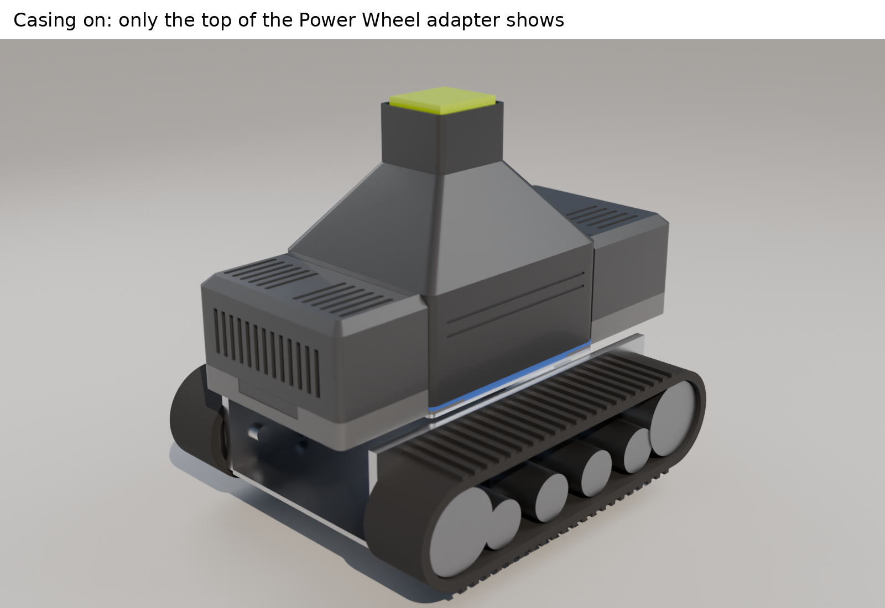
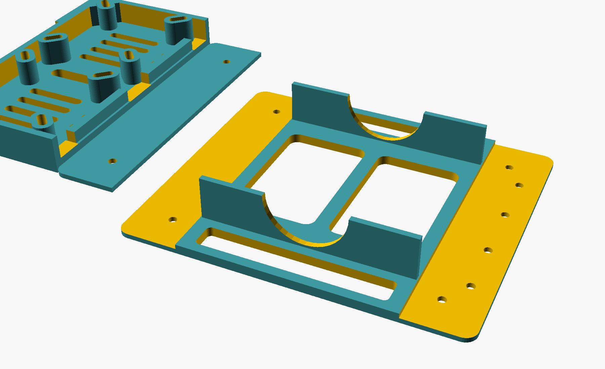
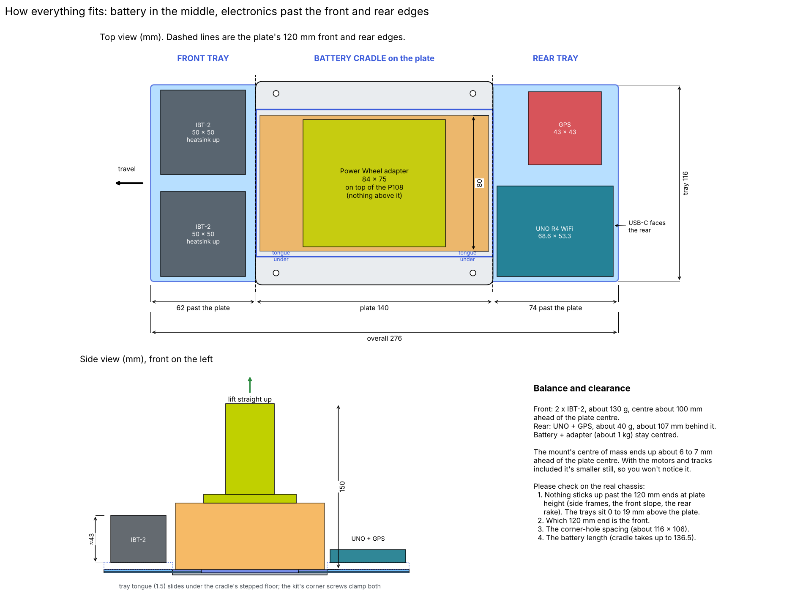
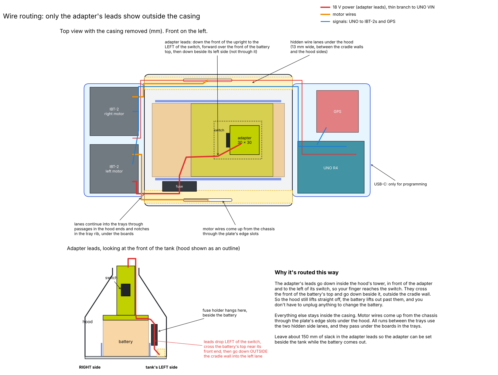
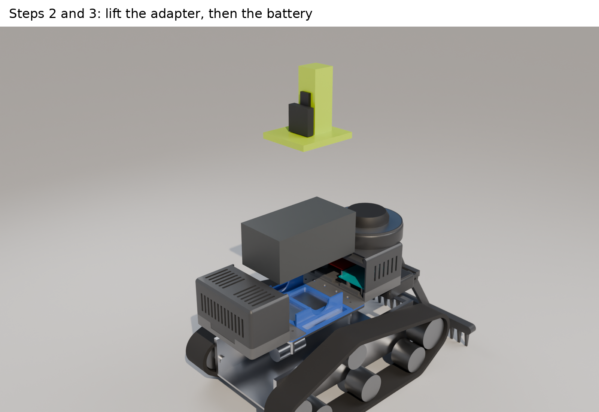
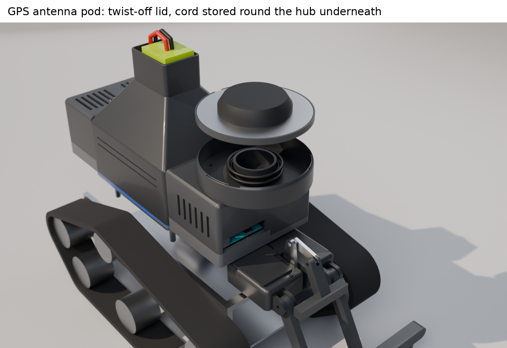
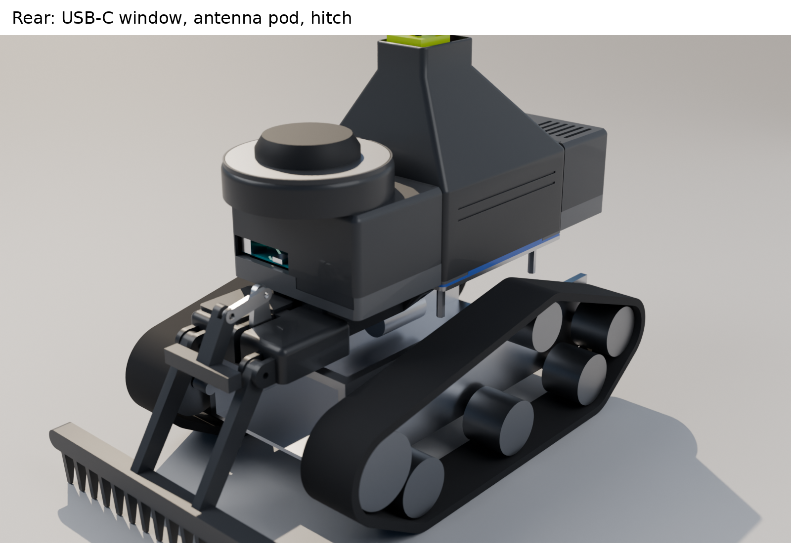
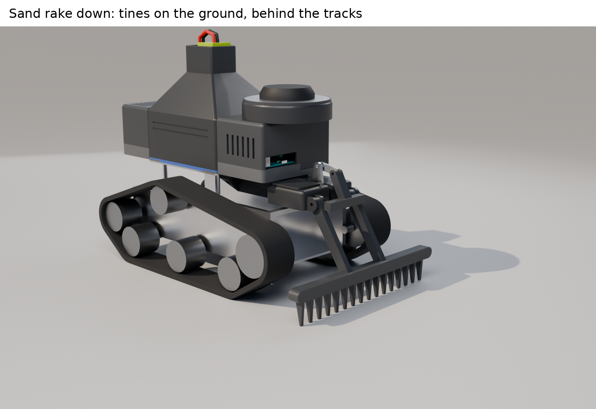
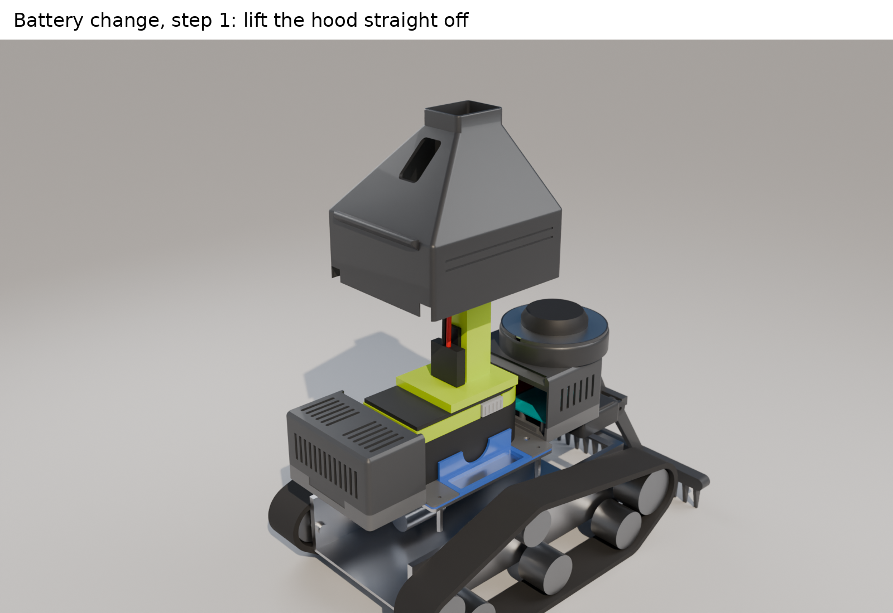

# Building the tank deck: step by step

This guide covers building the deck mount onto the Smart Robot Car tank chassis. It goes from printing the parts to a finished tank with the battery, the electronics, the GPS antenna and the rear hitch. The design notes and dimensions are in [README.md](README.md).

**Directions on the tank.** The **rear** is the end where the lower chassis runs on 100 mm past the plate, and the hitch goes there. The **front** carries the two IBT-2 motor drivers. The battery's flat end faces forward, and its curved end faces back. The adapter's switch faces forward.

---

## 1. Print the parts

All parts are PETG on a 0.4 mm nozzle with 0.2 mm layers, 4 walls, 5 top and 5 bottom layers, and 25% gyroid infill. The nozzle runs at 240 to 250 °C, and the bed at 70 to 80 °C on textured PEI. **No part needs supports.** Every STL is already in its print orientation, so print it as it loads.

| Part (in `stl/`) | Qty | Lay it on the bed | Status |
|---|---|---|---|
| `deck_mount_base` | 1 | Flat bottom down | Ready. Print this first and test-fit it on the plate. |
| `deck_mount_front_tray` | 1 | Floor down | Ready |
| `deck_mount_rear_tray` | 1 | Floor down | Ready |
| `deck_mount_front_cover` | 1 | Top down (already flipped) | Ready |
| `deck_mount_rear_cover` | 1 | Top down (already flipped) | Ready |
| `deck_mount_hood` | 1 | Open side down | Ready |
| `antenna_pod_cup` | 1 | Floor down | Ready |
| `antenna_pod_lid` | 1 | Flat, lugs down | Ready |
| `hitch_hitch` | 1 | Flat bottom down, 6 walls, 40% infill | Ready (bolts match the measured slots, [diagram](images/15_measure_rear_slots.png)) |
| `hitch_lid`, `hitch_lift_arm`, `hitch_link` | 1 each | Flat | Ready |
| `hitch_rake_frame`, `hitch_rake_bar` | 1 each | As loaded (the bar prints tines up) | Ready |
| `hitch_drawbar` | 1 | As loaded | Ready |

For a slick finish on the casing (hood and covers), use matte black PETG at 0.16 mm layers.

## 2. Get the hardware

| What | Qty | Used for |
|---|---|---|
| M3 screws, 4 mm longer than the kit's plate screws | 4 | Corners: tray tongue + base + plate into the kit standoffs |
| M3 x 12 + nut | 16 | 8 for the IBT-2s, 4 for the UNO, 4 for the GPS |
| M3 x 10 + nut | 3 | Antenna pod to the rear cover (nuts inside the cover) |
| 1/4-20 x 1/2" button-head bolt | 1 | Up through the pod lid into the antenna plate's welded nut |
| Cable ties (small) | about 10 | Through the slots near each plate edge |
| **Hitch only:** countersunk M3 x 16 + nut | 4 | Rear tray tongue + base + plate slots into the hitch clamp |
| **Hitch only:** countersunk M3 x 12 + nut | 2 | Rear tray floor down into the hitch beam |
| **Hitch only:** M3 x 8 | 6 | 4 servo ears, 2 for the servo lid |
| **Hitch only:** M4 x 30 + R-clip | 4 | 2 lower pins, plus 2 for the lift link |
| **Hitch only:** M3 x 20 + nut | 2 | Rake bar to the rake frame |
| **Hitch only:** DS3235 servo (35 kg·cm) with its metal round horn | 1 | Lifts the rake |
| **Hitch only:** 6 to 7.4 V BEC, 3 A or more | 1 | Powers the servo from the 18 V pack |

## 3. Prepare the chassis

1. Take out the 4 screws that hold the metal plate's corners to the chassis standoffs. Leave the plate in place.
2. Feed both motors' wires up through the slots near the plate's long edges. Those slots end up under the hood.

## 4. Base and trays

1. Set the **base** on the plate, flat bottom down, with its corner holes over the plate's corner holes. The cradle walls run front to back.
2. Lay the **front tray's** tongue into the 2 mm pocket at the front end of the base, so the tray hangs out over the front. Lay the **rear tray's** tongue into the rear pocket. Each tongue sits flush with the base floor.
3. Push the 4 longer corner screws down through tongue, base and plate into the standoffs. Snug them up but don't crush the plastic.
   - If you're fitting the hitch, leave the rear tray off for now (see step 6).

## 5. Electronics on the trays

1. **Front tray:** mount the two IBT-2 boards heatsinks up on the slotted standoffs, with 4x M3 x 12 + nut each. The slots let the holes line up even if a board's holes are slightly off.
2. **Rear tray:** mount the UNO R4 WiFi with its USB-C port facing the rear edge, where the cover's window is (4x M3 x 12). Then mount the GPS board beside it (4x M3 x 12).

## 6. Rear hitch (optional)

1. Lay the **servo** on its side in the hitch head's pocket, shaft toward the lift-arm slot. Screw its ears into the head with 4x M3 x 8.
2. Lay the servo cable in the channel along the top of the beam toward the plate.
3. Screw the **lid** over the servo pocket (2x M3 x 8).
4. Slide the hitch's clamp under the plate's rear edge, with the beam running back under where the rear tray goes.
5. Put the **rear tray** back, tongue in its pocket. Push 4x countersunk M3 x 16 down through the tongue, the base and the plate's rear slots into the nuts in the clamp. They sit flush, so the battery stands on them.
6. Screw the rear tray floor to the beam with 2x countersunk M3 x 12 (the holes are already in the tray). Then fit the rear corner screws.
7. Bring the servo cable up through the rear tray's wire slot to the UNO (signal to D3). Power it from the BEC at 6 to 7.4 V, not from the UNO's 5 V.
8. Bolt the **lift arm** to the servo horn.

## 7. Wiring

The only wires that show outside the finished shell are the adapter's two leads.

1. **Motors:** run the motor wires forward along the side lanes beside the cradle walls to the IBT-2 motor terminals, left motor to the left driver.
2. **Signals and UNO power:** run the UNO-to-IBT-2 signal wires, and a thin 18 V feed to the UNO's VIN, along the right lane between the trays. Each IBT-2 takes its logic VCC from the UNO's 5 V, never from the battery.
3. **Battery power** comes from the adapter in step 8. Its leads go to the IBT-2 B+ / B- terminals through the left lane.
4. Tie the bundles down with cable ties through the slots near the plate edges, so nothing rides up into the hood.
5. The motors are rated 7 to 15 V. The sketch must cap the motor PWM (`MOTOR_PWM_LIMIT`) so they never see the full 18 to 20 V. That cap is already on main.

## 8. Battery and adapter

1. Drop the **P108 battery** straight down into the cradle, with its flat end toward the front and its curved end toward the rear.
2. Slide the **Power Wheel adapter** onto the battery so its switch faces the front.
3. The leads come out of the top of the upright. Loop them forward and down in front of the upright, and let the **fuse holder** hang in that gap. Then run them down to the side lane. Leave about 150 mm of slack so the adapter can be lifted off and set beside the tank.

## 9. Antenna pod (before the rear cover goes on)

1. Set the **pod cup** on top of the rear cover, over the three holes. From inside the cover, fix it with 3x M3 x 10 and nuts.
2. Feed the antenna's SMA plug down through the 10 mm hole in the cup's floor and the cover. It comes out above the GPS. Connect it to the GPS.
3. Wind the spare cord round the cup's hub.
4. Bolt the antenna's **steel plate** to the **lid** with the 1/4-20 button-head bolt from below, into the plate's welded nut. Stick the magnetic antenna on the plate.
5. Turn the lid onto the cup (a 3-lug bayonet twist), with the notch in its rim facing the antenna cable.

## 10. Covers and hood

1. **Front cover:** hook its outer tab into the pocket in the front tray's bumper, then lower it until it sits on the tray walls. The nub clicks into its groove.
2. **Rear cover:** the same on the rear tray. Its window lines up with the UNO's USB-C port.
3. **Hood:** lower it straight down over the adapter, guiding the leads and the fuse holder up through the tower opening. Its two lips drop into the seats on the covers, which locks the covers down. Only the top 4 mm of the adapter and its leads stick out. The finger window in the front of the tower lines up with the switch.

## 11. Tools on the hitch

- **Sand rake:** hang the rake frame's arms on the two lower pins (M4 x 30 + R-clips). Pin the link between the lift arm and the rake's mast.
- **Trailer:** hang the drawbar on the same two lower pins and pin the link to its mast. The trailer's tongue eye drops over the 6 mm swivel pin at the back.

To swap tools, pull the 3 pins.

## Changing the battery (no tools)

1. Turn the switch off through the finger window.
2. Lift the **hood** straight up. It slides off over the adapter and the leads.
3. Press the adapter's release latches and lift the **adapter** straight up. Set it beside the tank; its leads stay connected.
4. Press the battery's latches and lift the **battery** straight out. The finger scoops in the cradle walls help.

To refit, drop the battery back in (flat end forward), then the adapter (switch forward), then lower the hood.
