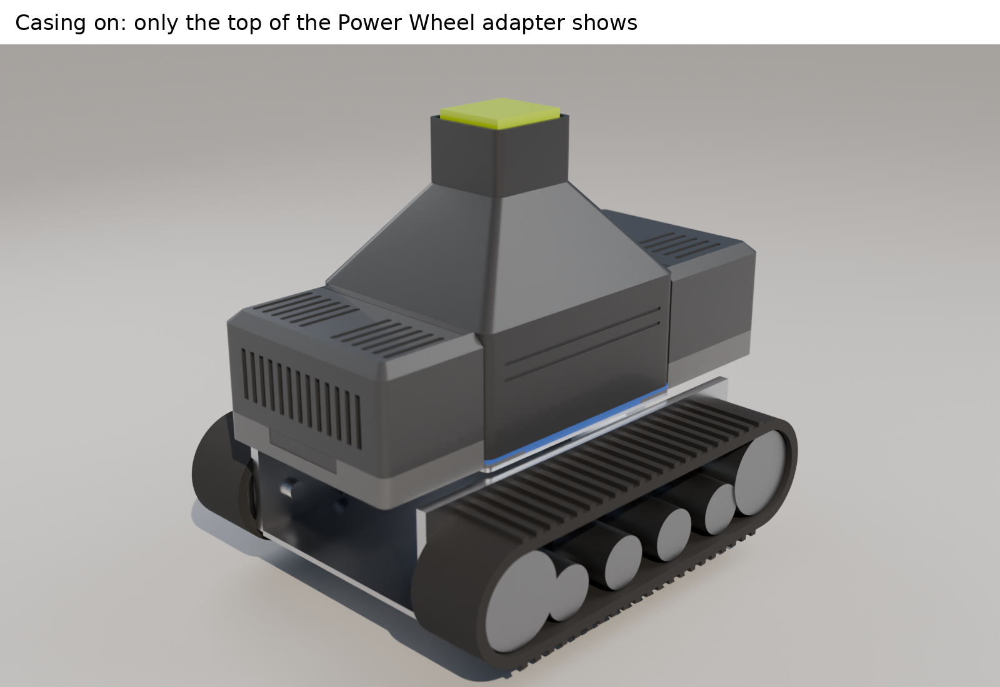
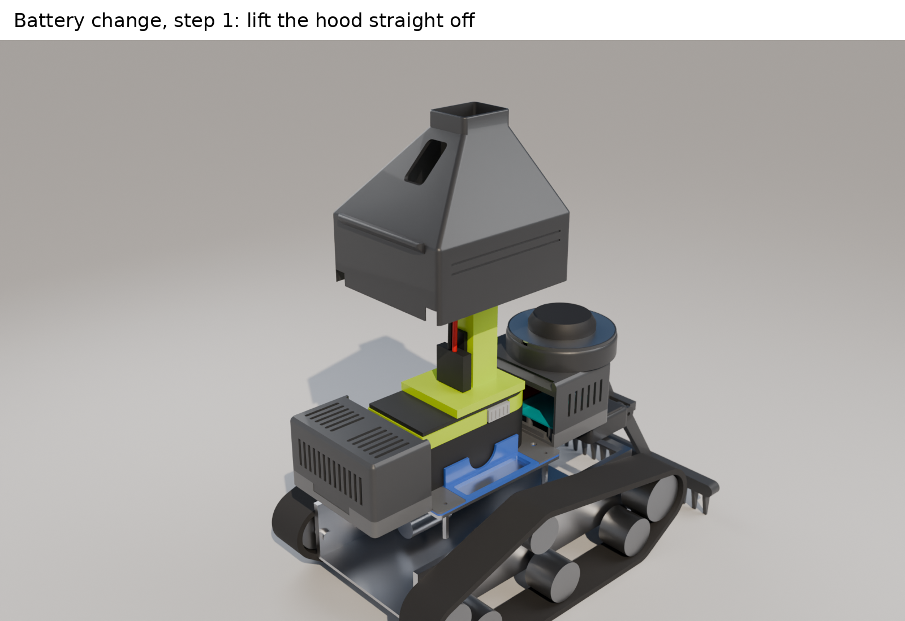
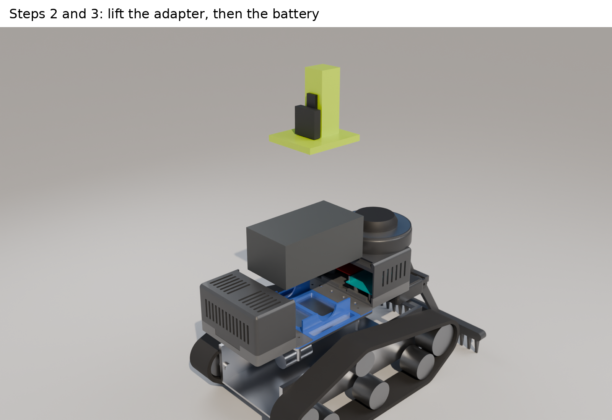
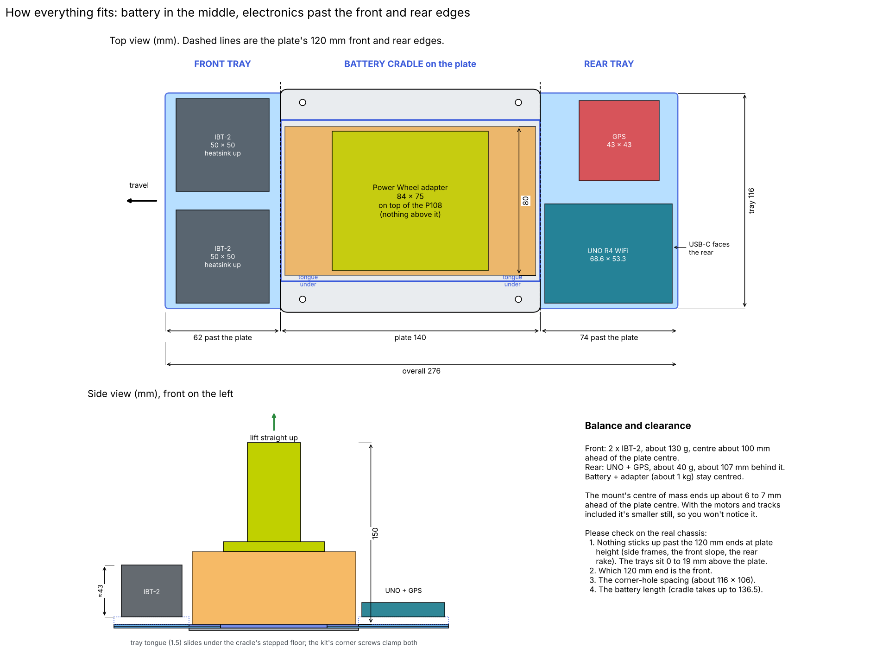
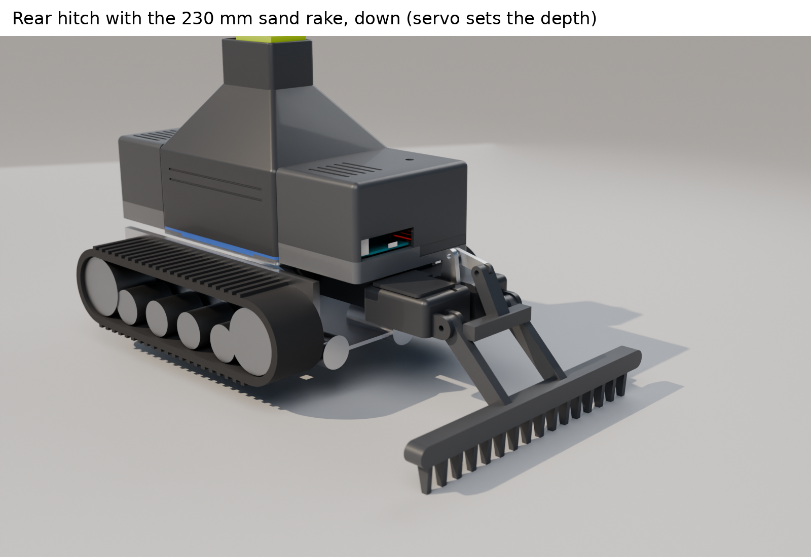

# Tank deck mount: Ryobi P108 battery + Power Wheel adapter + electronics, with casing

A printable mount and casing for the full-metal tank chassis (plate 140 x 120 mm):

- **Battery cradle** in the middle, on the plate. The Ryobi P108 4 Ah battery (135 x 80 mm, 720 g) stands in it along the 140 mm side, with the Power Wheel adapter (84 x 75 mm base, 90 mm tall) on top: 150 mm together. No boards are above the battery.
- **Front tray** overhanging the front 120 mm edge by 62 mm, carrying both IBT-2 drivers, heatsinks up.
- **Rear tray** overhanging the rear 120 mm edge by 80 mm, carrying the UNO R4 WiFi (USB-C facing the rear) and the GPS board.
- **Casing**: a hood over the battery that shows only the top of the adapter, and a cover over each tray. No tools needed.

The trays are built to take knocks: a 5 mm floor, a 5 mm bumper wall across the outer end, 3 mm side walls, corner gussets, and a cross rib where the tray meets the plate. Each tray has a 2 mm tongue that slides **under** the cradle's stepped floor ends (a half-lap joint), and the kit's corner screws clamp tongue + cradle to the metal plate.

Source: `tank_deck_mount.scad` (OpenSCAD, fully parametric). STLs are in `stl/`, pictures in `images/`, the 2-D drawings come from `drawings/make_drawings.py`, and the realistic renders from `render/` (Blender Cycles).

## Renders

| | |
|---|---|
|  |  |
|  |  |

The chassis, tracks, battery and boards in the renders are stand-ins for context. Only the printed parts are to scale from the CAD.

## Drawings





## Changing the battery (no tools)

1. Lift the hood straight up. It slides off over the adapter.
2. Lift the adapter straight up and set it beside the tank. Its leads stay connected (250 mm lead).
3. Lift the battery straight out. Finger scoops in the cradle walls give you a grip.

Reverse to refit. The hood's two lips drop into seats on the front and rear covers, which is what holds the covers down.

## Rear hitch (trailers and the sand rake)



| | |
|---|---|
|  |  |

Source: `hitch.scad`. It works like a small tractor hitch, so any tool swaps by pulling 3 pins:

- **Two lower pins** (M4 x 30 with R-clips) at the back of the hitch head, 60 mm apart. A tool or a trailer drawbar hangs on them and can pivot up and down.
- **One lift point.** A DS3235 servo (35 kg·cm, metal gear) lies in the hitch head and swings a lift arm. A short link pins from the arm to the tool's mast.
- **Sand rake:** 230 mm wide, 4 mm tines 28 mm long. It runs from 8° deeper than resting down to 28° raised, where the tines are about 25 mm clear of the ground, for turns. The servo sets the depth. At full drag (about 20 N, which is about all the tracks can pull) it needs about half the servo's torque.
- **Trailer:** the drawbar hangs on the same two pins and is held level by the link. A 6 mm vertical swivel pin at its back end takes the trailer's tongue eye. The mower trailer in the render is a stand-in.

**Mounting to the metal:** a clamp sits under the plate's rear edge. 4x countersunk M3 x 16 go down through the cradle floor, the rear tray's tongue and the plate's two long rear slots into nuts in the clamp. They sit flush, so the battery stands on them. The rear tray floor is screwed down onto the hitch beam with 2x countersunk M3 x 12, so knocks on the rear tray also go into the plate.

**Servo cable:** it runs from the servo pocket in a channel along the top of the beam, which the rear tray floor closes. It then comes up through the rear tray's wire slot to the UNO (D3). No wire shows.

| STL | Qty | Notes |
|---|---|---|
| `hitch_hitch.stl` | 1 | Clamp, beam and head in one piece, printed upright (flat bottom). The clamp wings have 45° undersides. Use 6 walls and 40% infill |
| `hitch_lid.stl` | 1 | Servo pocket lid, 2x M3 |
| `hitch_lift_arm.stl` | 1 | Bolts to the servo's round metal horn |
| `hitch_link.stl` | 1 | Arm to tool mast, M4 pins |
| `hitch_rake_frame.stl`, `hitch_rake_bar.stl` | 1 each | Rake. The bar prints tines-up. Join them with 2x M3 |
| `hitch_drawbar.stl` | 1 | Trailer adapter |

**Check before printing the hitch:**
- The position of the plate's rear slots. I traced them from the photo at about 11 mm in from the rear edge.
- That nothing on the chassis sits under the plate's rear edge, or directly behind it below the rear tray, down to 30 mm below the plate.
- The plate thickness. I assumed 2 mm.

## Wire routing (only the adapter's leads show)

- **Adapter leads** come out of the top of the adapter. They loop over and drop down inside the hood's tower, which has a 12 mm gap in front of the adapter for them. Inside, they cross the battery top to a side lane and run forward to the IBT-2s. Because the leads sit inside the tower opening, the hood still lifts straight off over them, and you don't unplug anything to change the battery. Leave about 150 mm of slack so the adapter can be set beside the tank.
- **Hidden side lanes:** two 13 mm channels run the length of the plate between the cradle walls and the hood's sides. Passages in both ends of the hood lead into the trays, and notches in each tray's rib let the wires pass under the boards.
- **Motor wires** come up from the chassis through the plate's edge slots, which are under the hood, and run forward along the lanes to the IBT-2 motor terminals (left motor to the left driver).
- **Signals** (UNO to both IBT-2s) and a thin 18 V feed to the UNO's VIN run along the right lane between the trays. The GPS wiring stays inside the rear cover.
- The USB-C port is reached through the window in the rear cover and is only used for programming.

## Rounded edges (5 mm)

All outside edges of the hood, the covers and the tray bumper corners have a 5 mm radius. Exceptions, where 5 mm doesn't fit:

| Where | Radius | Why |
|---|---|---|
| Hood tower top rim | 1.2 mm | The wall is only 2.4 mm thick |
| Hood lip tips | 2.5 mm | The lip tip is 3 mm thick |
| Hood bottom edge, cover bottom edges, tray wall tops | square | Mating faces, so the seams close flush |
| Cover ends against the hood | square | Mating face with the hood's end wall |
| Bottom edges on the print bed (trays, base, hood) | square | A radius on the bed edge would be an unsupported overhang |
| Cover top edges, last 1.5 mm | 45° chamfer blended into the 5 mm round | The covers print top down, so this keeps the bed edge printable. It looks the same as the full round |
| Inside corners of the shells | 2.6 mm | 5 mm outside minus the 2.4 mm wall |
| Base cradle | 5 mm on the outside corners only | It's hidden under the hood |

## How the casing stays on

- **Hood:** located by its tower around the adapter (2.5 mm clearance) and by its own weight. It just lifts off.
- **Covers:** each one has a tab with a small nub at the outer end that drops into a pocket in the tray's bumper. Tilt the cover in, tab first, then lower the plate end. The hood's lip then sits on top of the cover's plate end and stops it lifting. To remove a cover, take the hood off first.
- **Openings:** vent slots over both IBT-2 heatsinks and a grille in the front face. In the rear cover: a window for the UNO's USB-C and barrel jack, vents, and a 6.6 mm hole above the GPS for an SMA antenna bulkhead. The hood has wire passages at both bottom ends into the trays

## Parts

| STL | Qty | Size (mm) | Print orientation |
|---|---|---|---|
| `deck_mount_base.stl` | 1 | 140 x 120 x 22 | Floor down |
| `deck_mount_front_tray.stl` | 1 | 88 x 120 x 16 | Floor down |
| `deck_mount_rear_tray.stl` | 1 | 106 x 120 x 16 | Floor down |
| `deck_mount_hood.stl` | 1 | 152 x 120 x 146 | Open side down. The shoulder slopes at 45° or steeper, and the lips have 45° undersides |
| `deck_mount_front_cover.stl` | 1 | 62 x 116 x 60 | Top down (the STL is already flipped) |
| `deck_mount_rear_cover.stl` | 1 | 80 x 116 x 60 | Top down (the STL is already flipped) |

None of them need supports, and all fit the A1's 256 mm bed. About 300 g of PETG at the settings below.

## Balance

The battery and adapter (about 1 kg) stay centred on the plate. The front tray carries about 130 g of drivers about 100 mm ahead of the plate centre, and the rear tray about 40 g about 110 mm behind it. The casing is close to symmetric. The centre of mass moves about 6 to 7 mm forward, and less once the motors and tracks are counted.

## Dimensions and where they came from

| Item | Value | Source |
|---|---|---|
| Chassis plate | 140 x 120 mm | Measured by John |
| Plate corner holes | about 116 x 106 mm apart, about 12 / 7 mm in from the edges | Traced from `Images/BasePlate.png` and scaled. **Approximate, please measure** |
| P108 battery footprint | 135 x 80 mm | `Archive/Battery+VR.f3d` |
| Battery + adapter height | 150 mm | Measured by John |
| Power Wheel adapter | 84 x 75 mm base, 90 mm tall, 250 mm lead | Listing photo |
| Adapter tower | 41 x 34 mm, 90 mm above the battery, leads out the top (casing opening 56 x 39, with a 12 mm lead gap in front) | Measured by John |
| IBT-2 | 50 x 50 board, 40 x 40 holes, about 43 tall | `Archive/MotorBox.f3d` |
| GPS | 43.2 board, 38.1 holes (SparkFun GPS-RTK2) | `Archive/GPSBox.f3d` |
| UNO R4 WiFi | Standard UNO pattern | Arduino datasheet |

### Check before printing

1. **Clearance past the 120 mm ends.** The trays sit 0 to 15 mm above the plate, the covers reach 69 mm, and they stick out 62 mm forward and 80 mm back. Check that the side frames, the front slope and the rear rake don't get in the way. `front_ovh`, `rear_ovh` and `tray_W` (116, inside the plate width) are adjustable.
2. **Which end is the front.** The drawings assume the IBT-2s go at the front (closer to the motors). Swap the trays if not; the tongues are the same.
3. **Corner-hole spacing.** Print the base first and test-fit it.
4. **Battery length.** The hood's end walls take a battery up to 136.8 mm. The file refuses to render if `bat_L` doesn't fit.
5. **Adapter tower orientation.** The model assumes the 41 mm side runs front to back. If it's the other way, swap `tower_L` and `tower_W`.

## Hardware

- 4x M3 corner screws through cradle + tongue into the chassis. The stack is 4 mm thick, so use the kit screws plus 4 mm.
- 8x M3 x 12 + nut for the IBT-2s, 4x for the UNO and 4x for the GPS.
- Cable ties through the slots near each plate edge to hold the wiring.

## Print settings (PETG, Bambu A1 or similar)

- 0.4 mm nozzle, 0.2 mm layers, 4 walls, 5 top and bottom layers, 25% gyroid infill.
- Nozzle 240 to 250 °C, bed 70 to 80 °C, textured PEI or glue stick.
- No supports. Each STL is already in its print orientation (see Parts). Every part fits a 256 mm bed. For a slick finish on the casing, print it in matte black PETG with 0.16 mm layers and use a textured PEI sheet for the covers (they print top down).

## Changing the design

Every dimension is a named variable at the top of `tank_deck_mount.scad`:

```
openscad -D 'part="front_tray"' -o stl/deck_mount_front_tray.stl tank_deck_mount.scad
```

`part` can be `assembly`, `base`, `front_tray`, `rear_tray`, `hood`, `front_cover` or `rear_cover`. In `hitch.scad` it can be `hitch`, `lid`, `lift_arm`, `link`, `rake_frame`, `rake_bar`, `drawbar` or `hitch_asm`, plus `tool` and `rake_lift` for the pictures. The assembly also takes `hood_lift`, `cap_lift`, `bat_lift`, `explode` and `show_case` for the pictures.

Realistic renders: `render/parts.scad` exports the scene meshes, and `render/render.py` renders them with Blender's Python module (`pip install bpy`):

```
python render/render.py -- <mesh folder> out.png front34 64
```
