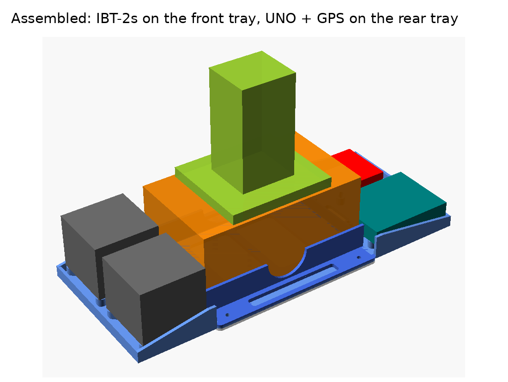
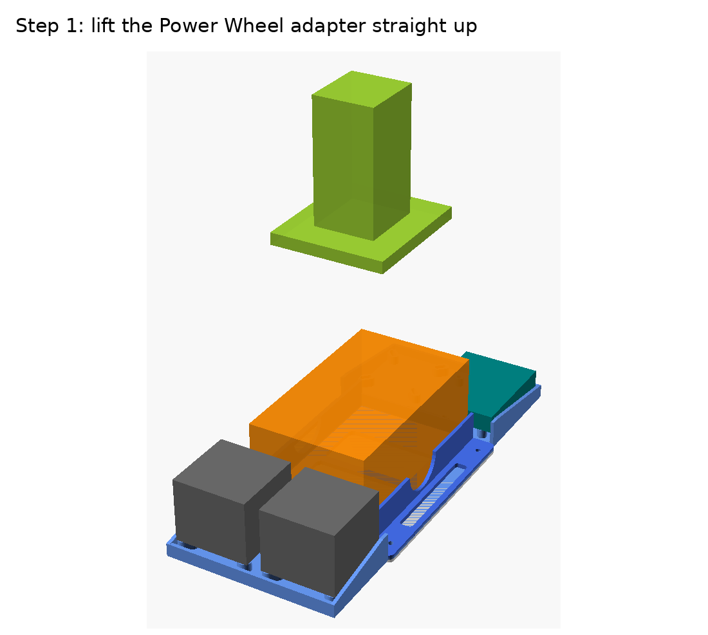
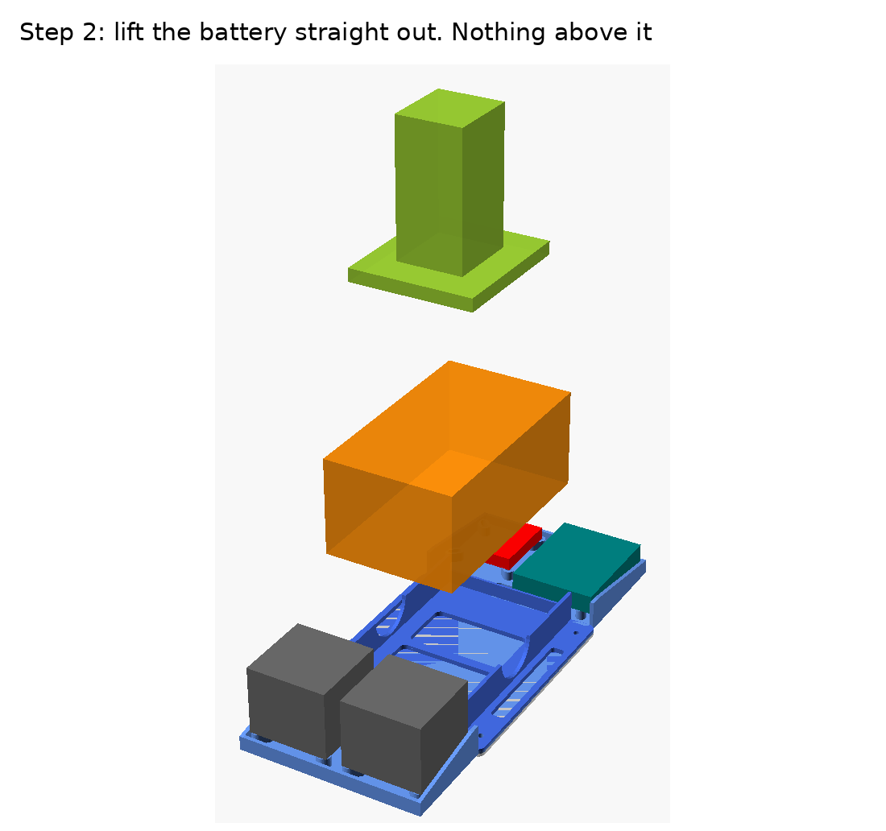
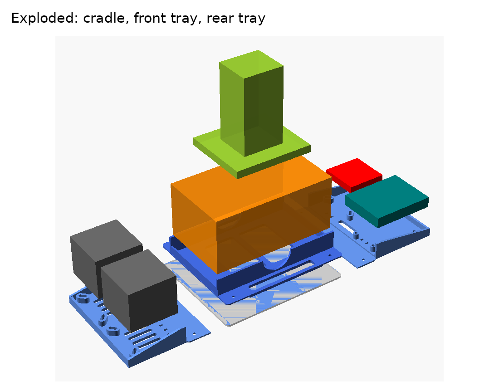
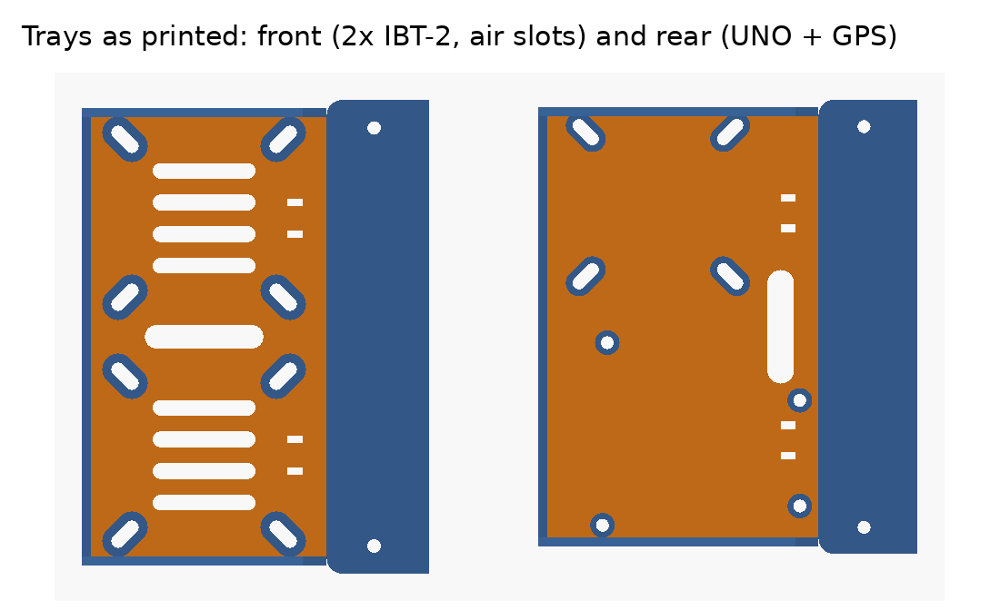

# Tank deck mount: Ryobi P108 battery + Power Wheel adapter + electronics

A printable three-piece mount for the full-metal tank chassis (plate 140 x 120 mm):

- **Battery cradle** in the middle, on the plate. The Ryobi P108 4 Ah battery (135 x 80 mm, 720 g) stands in it along the 140 mm side, with the Power Wheel adapter (84 x 75 mm base, 90 mm tall) on top: 150 mm together. **Nothing is above the battery.**
- **Front tray** overhanging the front 120 mm edge by 62 mm, carrying both IBT-2 drivers with their heatsinks up in open air, over air slots.
- **Rear tray** overhanging the rear 120 mm edge by 74 mm, carrying the UNO R4 WiFi (USB-C facing the rear) and the GPS board.

Each tray has a 1.5 mm tongue that slides **under** the cradle's stepped floor ends (a half-lap joint). The kit's corner screws go through cradle + tongue into the chassis, so each tray is clamped straight to the metal plate by two screws. Side rails on each tray rise to 19 mm where they meet the plate edge to stiffen the overhang.

Source: `tank_deck_mount.scad` (OpenSCAD, fully parametric). STLs are in `stl/`, pictures in `images/`, and the 2-D drawings come from `drawings/make_drawings.py`.

## Drawings


## Pictures

| | |
|---|---|
|  |  |
|  |  |
|  | |

The battery (orange), adapter (green) and boards are stand-in blocks.

## Taking the battery out to charge (no tools)

1. Lift the adapter straight up off the battery and set it beside the tank. Its leads stay connected (250 mm lead).
2. Lift the battery straight out. Finger scoops in the side walls give you a grip.

## Parts

| STL | Qty | Size (mm) | Notes |
|---|---|---|---|
| `deck_mount_base.stl` | 1 | 140 x 120 x 22 | Battery cradle. Floor ends are stepped to 1.5 mm for the tray tongues |
| `deck_mount_front_tray.stl` | 1 | 88 x 120 x 19 | 2x IBT-2 on slotted standoffs (±2.5 mm), air slots, wire slot between drivers |
| `deck_mount_rear_tray.stl` | 1 | 100 x 120 x 19 | UNO R4 WiFi + GPS, wire slot between them |

About 100 to 120 g of PETG at the settings below (130 g solid). Overall length assembled: 276 mm.

## Balance

The battery and adapter (about 1 kg) stay centred on the plate. The front tray carries about 130 g of drivers about 100 mm ahead of the plate centre; the rear tray carries about 40 g about 107 mm behind it. The mount's centre of mass moves about 6 to 7 mm forward, less once the motors and tracks are counted. Without the deck, the centre of mass is lower than the previous design (the battery is the only tall item).

## Dimensions and where they came from

| Item | Value | Source |
|---|---|---|
| Chassis plate | 140 x 120 mm | Measured by John |
| Plate corner holes | about 116 x 106 mm apart, about 12 / 7 mm in from the edges | Traced from `Images/BasePlate.png` and scaled. **Approximate, please measure** |
| P108 battery footprint | 135 x 80 mm | `Archive/Battery+VR.f3d` |
| Battery + adapter height | 150 mm | Measured by John |
| Power Wheel adapter | 84 x 75 mm base, 90 mm tall, 250 mm lead | Listing photo |
| IBT-2 | 50 x 50 board, 40 x 40 holes | `Archive/MotorBox.f3d` |
| GPS | 43.2 board, 38.1 holes (SparkFun GPS-RTK2) | `Archive/GPSBox.f3d` |
| UNO R4 WiFi | Standard UNO pattern | Arduino datasheet |

### Check before printing

1. **Clearance past the 120 mm ends.** The trays sit 0 to 19 mm above the plate and reach 62 mm forward and 74 mm back. Check that the side frames, the front slope and the rear rake don't get in the way. `front_ovh`, `rear_ovh` and `tray_W` (116, inside the plate width) are adjustable.
2. **Which end is the front.** The drawings assume the IBT-2s go at the front (closer to the motors). Swap the trays if not; the tongues are the same.
3. **Corner-hole spacing.** Print the base first and test-fit it.
4. **Battery length.** The cradle takes up to 136.5 mm. The file refuses to render if `bat_L` doesn't fit.

## Hardware

- 4x M3 corner screws through cradle + tongue into the chassis. The stack is 3 mm thick, so use the kit screws plus 3 mm.
- 8x M3 x 12 + nut for the IBT-2s, 4x for the UNO and 4x for the GPS.
- Cable ties through the slots near each plate edge to hold the wiring.

## Print settings (PETG, Bambu A1 or similar)

- 0.4 mm nozzle, 0.2 mm layers, 4 walls, 5 top and bottom layers, 25% gyroid infill.
- Nozzle 240 to 250 °C, bed 70 to 80 °C, textured PEI or glue stick.
- No supports. Each STL is in its print orientation, floor down. Every part fits a 256 mm bed.

## Changing the design

Every dimension is a named variable at the top of `tank_deck_mount.scad`:

```
openscad -D 'part="front_tray"' -o stl/deck_mount_front_tray.stl tank_deck_mount.scad
```

`part` can be `assembly`, `base`, `front_tray` or `rear_tray`. The assembly also takes `cap_lift`, `bat_lift` and `explode` for the pictures.
