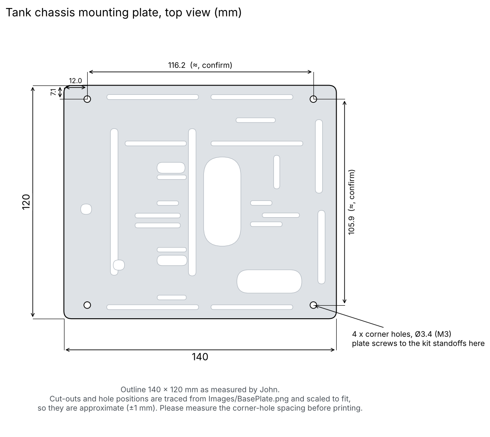
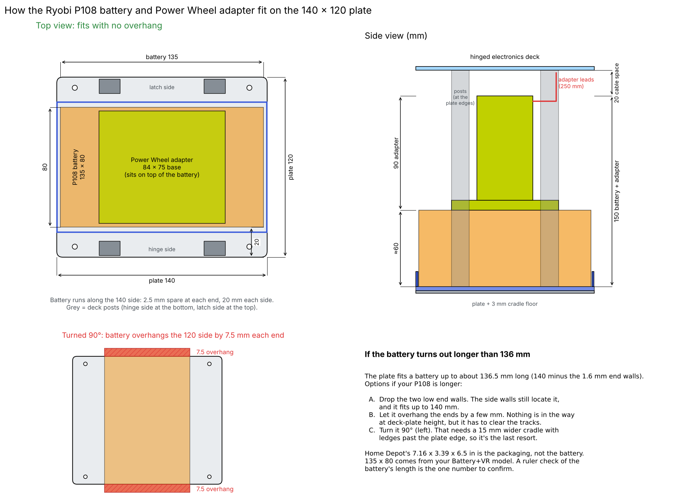
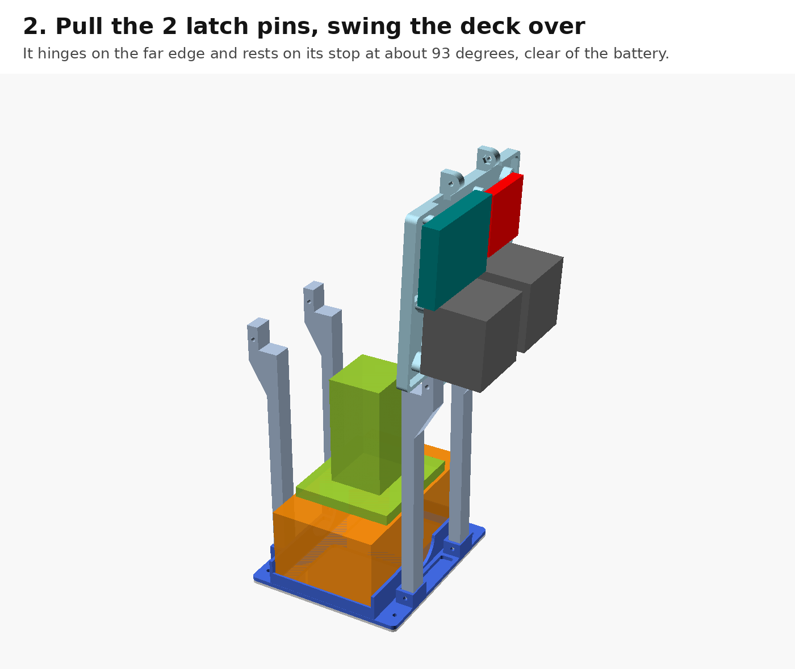
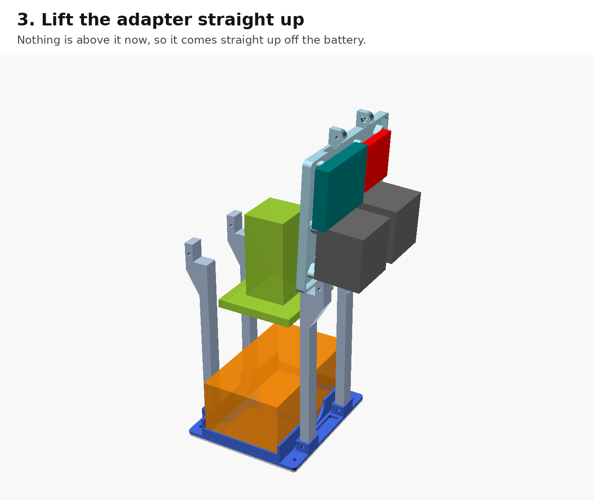
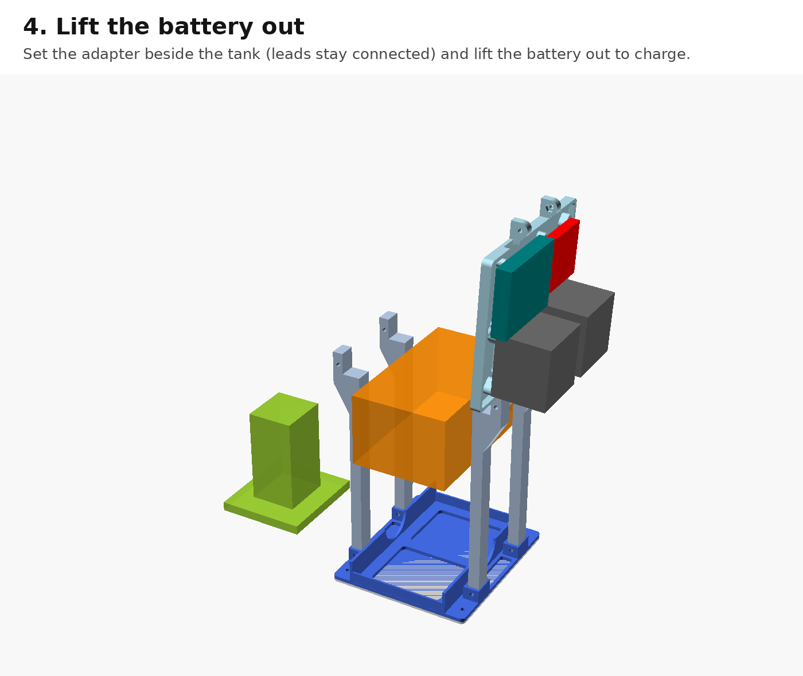

# Tank deck mount: Ryobi P108 battery + Power Wheel adapter + electronics

A printable two-tier mount for the full-metal tank chassis.

- **Lower tier:** a cradle bolted to the 140 x 120 mm chassis plate. The Ryobi P108 4 Ah battery (135 x 80 mm, 720 g) stands in it, lying along the 140 mm side, with the Power Wheel adapter (84 x 75 mm base, 90 mm tall) clipped on top. Together they stand 150 mm tall.
- **Upper tier:** an electronics deck on four posts, carrying the two IBT-2 drivers, the UNO R4 WiFi and the ZED-F9P GPS board.

The adapter has to lift straight up before the battery comes out, so the deck is **hinged on one 140 mm edge**. To open it, pull two thumb-screw pins on the opposite edge and swing the deck over. It rests on a built-in stop with nothing left above the battery.

Source: `tank_deck_mount.scad` (OpenSCAD, fully parametric). STLs are in `stl/`, pictures are in `images/`, and the 2-D drawings come from `drawings/make_drawings.py`.

## Drawings




## Pictures

| | |
|---|---|
|  |  |
|  |  |
|  |  |

The battery (orange), adapter (green) and boards are stand-in blocks.

## Taking the battery out to charge (no tools)

1. Unscrew and pull out the two thumb-screw pins on the latch side.
2. Swing the deck up and over the hinge side. It stops by itself at about 93°.
3. Lift the adapter straight up off the battery and set it beside the tank. Its leads stay connected.
4. Lift the battery out. Finger scoops in the side walls give you a grip.

**Wire slack:** the adapter's 250 mm lead is enough to set it down beside the tank. Leave about 60 mm of slack wherever the deck wiring crosses the hinge edge.

## Parts

| STL | Qty | Size (mm) | Notes |
|---|---|---|---|
| `deck_mount_base.stl` | 1 | 140 x 120 x 22 | Battery cradle. Bolts to the plate's 4 corner holes |
| `deck_mount_post_x4.stl` | 4 | 188 x 24 x 14 | All four posts are the same part. On the latch side they're turned round |
| `deck_mount_deck.stl` | 1 | 140 x 148 x 13.5 | Electronics deck with pin lugs on both 140 mm edges |

About 200 to 230 g of PETG at the settings below (283 g if printed solid).

## Dimensions and where they came from

| Item | Value | Source |
|---|---|---|
| Chassis plate | 140 x 120 mm | Measured by John |
| Plate corner holes | about 116 x 106 mm apart, about 12 / 7 mm in from the edges | Traced from `Images/BasePlate.png` and scaled to 140 x 120. **Approximate, please measure** |
| P108 battery footprint | 135 x 80 mm | `Archive/Battery+VR.f3d`. Home Depot's 7.16 x 3.39 x 6.5 in is the packaging |
| Battery + adapter height | 150 mm | Measured by John |
| Power Wheel adapter | 84 x 75 mm base, 90 mm tall, 250 mm lead | Listing photo |
| IBT-2 holes | 40 x 40 mm | `Archive/MotorBox.f3d` |
| GPS holes | 38.1 x 38.1 mm (SparkFun GPS-RTK2) | `Archive/GPSBox.f3d` |
| UNO R4 WiFi | Standard UNO pattern | Arduino datasheet |

### Check before printing

1. **Corner-hole spacing on the plate.** It's the one chassis number that isn't measured. Print the base first and test-fit it.
2. **Battery length.** The cradle fits a battery up to 136.5 mm long with its 1.6 mm end walls. `08_battery_fit.png` shows the options if it's longer. The file refuses to render if `bat_L` doesn't fit.
3. **Which edge is the front.** The layout works either way round. Put the hinge on whichever 140 mm edge is easier to reach. The UNO's USB-C faces one 120 mm end.

## Layout choices

- **Battery placement.** The battery is the heaviest item. It runs along the 140 mm side so it fits within the plate, with 2.5 mm spare at each end and 20 mm each side. It stands directly on the plate, centred, which is as low as it can go. Turned 90° it would overhang the 120 mm side by 7.5 mm at each end.
- **Hinge.** The hinge axis is 8 mm outboard of the plate edge. Opened, the whole deck sits outside the battery's footprint, so the adapter and battery lift straight out. I checked this numerically. At every angle up to the stop, the swinging deck and boards don't touch the posts, base, battery or adapter. The stop is the deck edge landing on the post's stop block at 93°. When open, the boards face outward, so the deck's weight holds it against the stop.
- **Deck layout.** The IBT-2s sit in a row along the hinge edge with their heatsinks up over air slots. Cooling isn't a concern, since the motors draw under 5.5 A at stall against the 43 A BTS7960 rating. The UNO and GPS sit along the latch edge.
- **Wiring.** There are pass-through slots at both ends of the deck and between the drivers for the motor and power wires, plus one between the UNO and the GPS. There's 20 mm of space above the adapter for its leads.
- **Centre of gravity.** With the deck about 175 mm above the plate, a rough estimate gives a side-tip angle of about 35°. The kit is rated for 30° climbs. This is an estimate, so tilt-test it. Swap the battery on level ground, since the open deck makes the tank lopsided.

## Hardware

- 4x M3 screws to the chassis through the cradle's corner holes. Use the kit screws plus 3 mm, since the floor is 3 mm.
- 4x M3 x 20 + nylock nut as cross pins through the cups and posts.
- 2x M3 x 25 + nylock nut as the hinge pins. Snug, not tight.
- 2x M3 x 25 knurled thumb screws as the latch pins. The M3 nut sits in the hex pocket in each latch lug.
- 8x M3 x 12 + nut for the IBT-2s, 4x for the UNO and 4x for the GPS.

## Print settings (PETG, Bambu A1 or similar)

- 0.4 mm nozzle, 0.2 mm layers, 4 walls, 5 top and bottom layers, 25% gyroid infill.
- Nozzle 240 to 250 °C, bed 70 to 80 °C, textured PEI or glue stick.
- No supports needed. Each STL is in its print orientation. The posts lie on their side (strong along their length), the deck lies flat with the lugs and standoffs up, and the base lies floor down.
- Every part fits a 256 mm bed. The posts are the longest at 188 mm.

## Changing the design

Every dimension is a named variable at the top of `tank_deck_mount.scad`:

```
openscad -D 'part="base"' -o stl/deck_mount_base.stl tank_deck_mount.scad
```

`part` can be `assembly`, `base`, `deck` or `post`. The assembly also takes `open_deg`, `cap_lift`, `bat_lift`, `cap_aside` and `explode` for the pictures.
