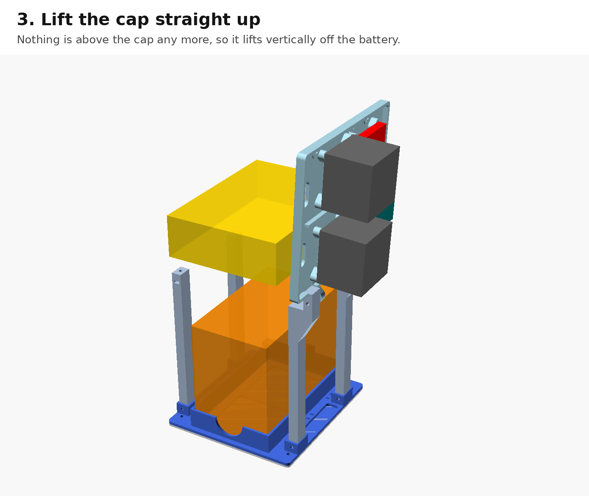
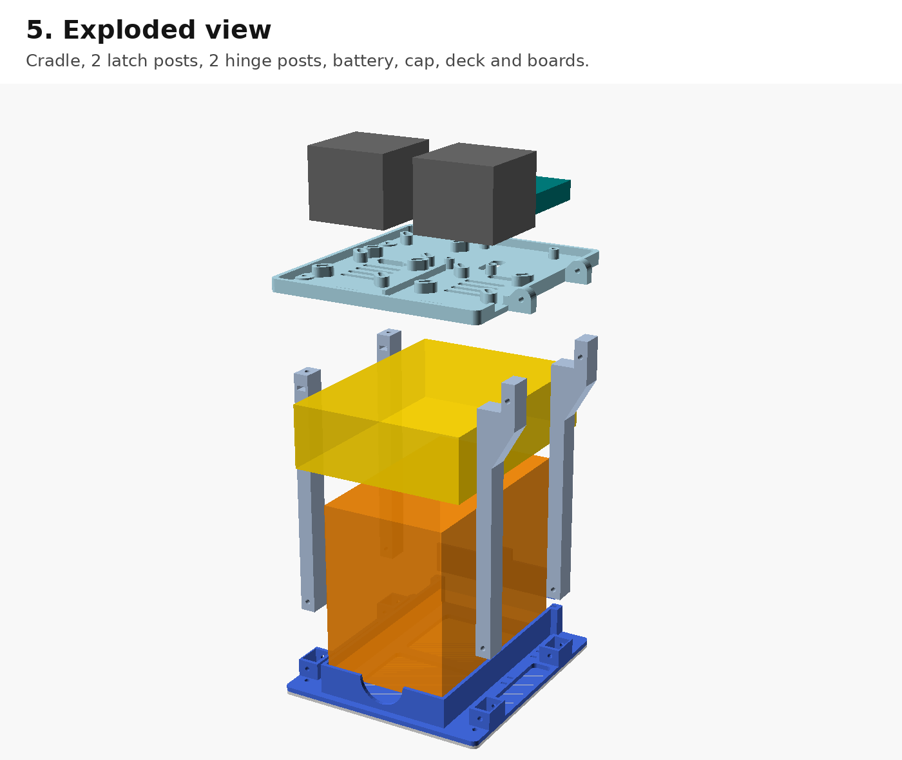
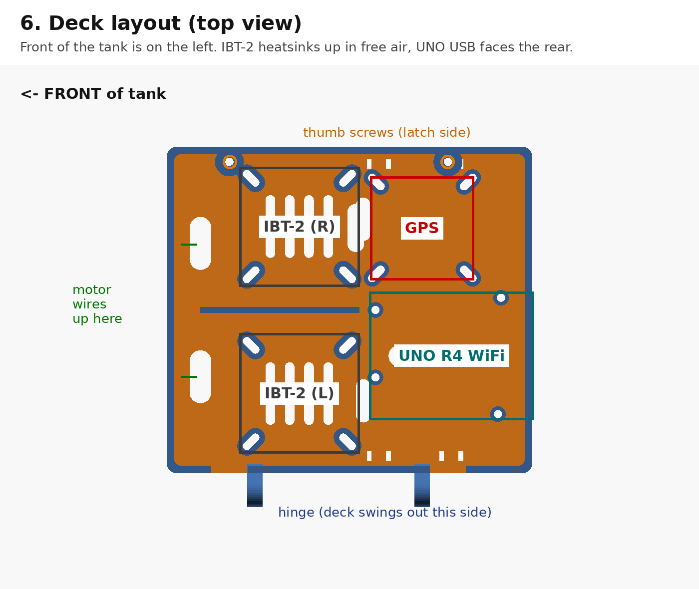

# Tank deck mount: Ryobi battery + electronics

A printable two-tier mount for the full-metal tank chassis. The Ryobi ONE+ battery stands rails-up in a cradle bolted to the chassis top plate, with its cap on top. The electronics deck sits above the cap on four posts and carries the two IBT-2 drivers, the UNO R4 WiFi and the ZED-F9P GPS board.

The cap has to come straight up off the battery before the battery can come out. So the deck is **hinged along its left edge**. Undo two thumb screws and it swings up and over to the left, where it rests on a built-in stop with nothing left above the cap.

Source: `tank_deck_mount.scad` (OpenSCAD, fully parametric). STLs are in `stl/`, pictures are in `images/`.

## Pictures

| | |
|---|---|
|  |  |
|  |  |
|  |  |

In the pictures the battery (orange), cap (yellow) and boards are plain stand-in blocks.

## Taking the battery out to charge (no tools)

1. Undo the two M3 thumb screws on the right-hand edge of the deck.
2. Lift the right edge and swing the deck over to the left. It stops by itself at about 93°, standing on the left side with the boards facing outward.
3. Lift the cap straight up off the battery and set it down beside the tank. Its wires stay connected.
4. Lift the battery out of the cradle. If the optional rear gate isn't fitted, you can slide it out the back instead.

To refit, reverse the steps. The deck drops back onto the posts, and the two thumb screws hold it down.

**Wire slack:** leave about 300 mm of free length on the cap's power leads so the cap can sit beside the tank. The deck's leads (motors, power) cross the hinge line on the left, so leave about 60 mm of slack there and they'll flex rather than pull.

## Parts

| STL | Qty | Size (mm) | Notes |
|---|---|---|---|
| `deck_mount_base.stl` | 1 | 151.6 x 135.3 x 22 | Battery cradle. Bolts to the chassis plate through the 4 corner holes |
| `deck_mount_hinge_post_x2.stl` | 2 | 170 x 24 x 14 | Left-hand posts. Carry the hinge pin and the open stop |
| `deck_mount_latch_post_x2.stl` | 2 | 153 x 10 x 14 | Right-hand posts. Captive nut for the thumb screw |
| `deck_mount_deck.stl` | 1 | 151.6 x 149 x 13.5 | Electronics deck with 2 hinge lugs on the left edge |
| `deck_mount_gate.stl` | 1 | 89 x 28 x 2.4 | Optional rear gate. Stops the battery sliding backwards |

About 200 to 230 g of PETG in total at the settings below (287 g if printed solid).

## Where the dimensions came from

| Item | Value | Source |
|---|---|---|
| Chassis top plate | 151.6 x 135.3 mm | Measured from `Images/BasePlate.png` (300 dpi scan). The kit drawing in `Archive/TankSpecs.docx` says 138 mm across |
| Plate corner holes | 4 holes, 125.8 x 119.4 mm apart, at (13.0, 7.9) from the corner | Same scan |
| Battery footprint | 80 x 135 mm | `Archive/Battery+VR.f3d` |
| Battery + cap height | 150 mm, standing rails-up | Measured by John |
| Cap footprint | 110 x 148 mm | `Archive/RyobiBatteryHolder v7.f3d` |
| IBT-2 holes | 40 x 40 mm, 50 x 50 mm board | `Archive/MotorBox.f3d` |
| GPS board holes | 38.1 x 38.1 mm, 43.2 mm board (SparkFun GPS-RTK2) | `Archive/GPSBox.f3d` |
| UNO R4 WiFi holes | Standard UNO pattern, 68.6 x 53.3 mm | Arduino datasheet |

### Check before printing everything

1. **Corner holes.** These come from a scan, so they could be off by about 0.5 mm. Print the base first and test-fit it on the chassis.
2. **Cap width.** The posts leave about 1.8 mm each side of a 110 mm cap. If your cap is wider, reduce `post_y`. The file refuses to render if the posts would hit the cap.
3. **Front of the tank.** The scan doesn't show which edge is the front. The layout puts the battery stop wall and the IBT-2s at X = 0. If the motor wires come up at the other end, rotate the whole mount 180°.

The IBT-2 and GPS standoffs have radial slots, so a board whose hole spacing is off by up to about 2.5 mm still fits.

## Layout choices

**Battery access.** The hinge axis sits 8 mm outboard of the plate's left edge, over the gap above the track. That's why the opened deck ends up fully outside the cap's footprint, so the cap can lift as high as it needs to. I checked the hinge numerically. At every angle up to the stop, the swinging deck does not touch the posts, and once it is open no part of it reaches over the cap. The stop is the deck's left edge landing on the stop block of each hinge post. When open, the boards face outward, so the deck's weight keeps it pressed against the stop.

**Centre of gravity.** The battery is the heaviest item by far (roughly 0.7 to 1 kg). It stands directly on the plate, centred, which is as low as it can go upright. Lying on its side it would be 150 mm wide, wider than the 135 mm plate. The electronics weigh about 250 g and sit on the deck, about 160 mm above the plate. That's also where the GPS gets a clear view of the sky. A rough estimate puts the whole tank's centre of gravity about 130 mm above the ground, which means it would tip sideways at about 36°. The kit is rated to climb 30°. These are estimates, not measurements. A tilt test on a board will give the real number. With the deck open the tank is lopsided, so swap the battery on level ground.

**Wire runs.**
- Motor leads come up through the two front slots, right in front of the IBT-2 output terminals.
- Battery power runs up the left side (the hinge side) to the drivers and the buck converter(s).
- PWM leads to the UNO (D5/D6/D9/D10) are short because the UNO sits right behind the drivers.
- GPS TX/RX (pins 0/1) and 3.3 V go through the slot beside the GPS board, away from the motor wiring.
- The base's side channels beside the battery have cable-tie slots for the buck converter(s) and fuse.
- The UNO's USB-C faces the rear edge, so you can plug in for programming without opening anything.

**IBT-2 cooling.** The XR25-370 motors draw 1.5 A rated and under 5.5 A at stall (kit datasheet). The BTS7960 chips are rated 43 A, so they will barely get warm. Even so, the boards stand on 6 mm standoffs over air slots, with their heatsinks up in open air.

## Hardware

- 4x M3 screws to the chassis through the corner holes in the cradle floor. Use the original kit screws plus 3 mm, since the floor is 3 mm thick.
- 4x M3 x 20 + nylock nut as cross pins through the cups and posts. They run along the length of the tank.
- 2x M3 x 25 + nylock nut as hinge pins through the hinge posts and deck lugs. Snug, not tight, so the deck still swings.
- 2x M3 x 12 knurled **thumb screws** + M3 nut. The nut drops into the slot near the top of each latch post.
- 8x M3 x 12 + nut for the IBT-2s, 4x for the UNO and 4x for the GPS board.

## Print settings (PETG, Bambu A1 or similar)

- 0.4 mm nozzle, 0.2 mm layers, 4 walls, 5 top and bottom layers, 25% gyroid infill.
- Nozzle 240 to 250 °C, bed 70 to 80 °C. Use a textured PEI plate or glue stick. On smooth PEI, PETG can stick too well.
- No supports needed. Each STL is already in its print orientation:
  - Base: floor down.
  - Deck: flat side down. The standoffs and hinge lugs point up.
  - Posts: lying on their side. This puts the layers along the post's length, which is much stronger in bending, and the hinge-pin hole prints vertical.
  - Gate: flat.
- All parts fit a 256 mm bed. The longest part is the hinge post at 170 mm.

## Changing the design

Every dimension is a named variable at the top of `tank_deck_mount.scad`. Export one part:

```
openscad -D 'part="base"' -o stl/deck_mount_base.stl tank_deck_mount.scad
```

`part` can be `assembly`, `base`, `deck`, `hinge_post`, `latch_post` or `gate`. For pictures, the assembly also takes `open_deg`, `cap_lift`, `bat_lift`, `cap_aside` and `explode`. For example, `-D open_deg=93 -D cap_lift=70` gives picture 3.
