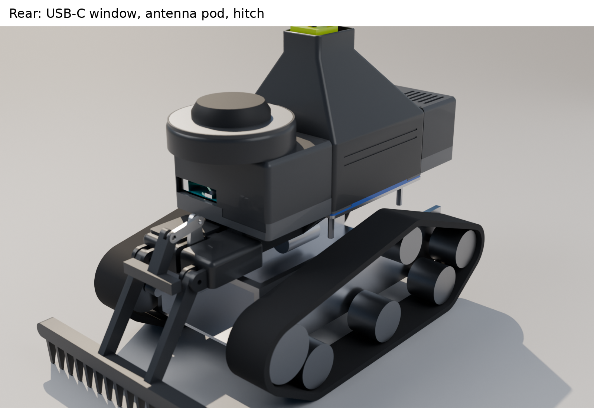
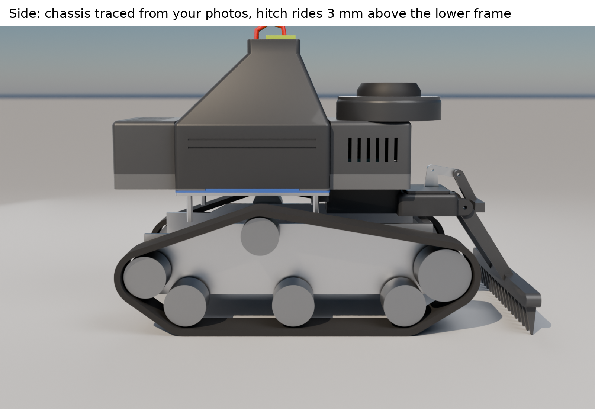
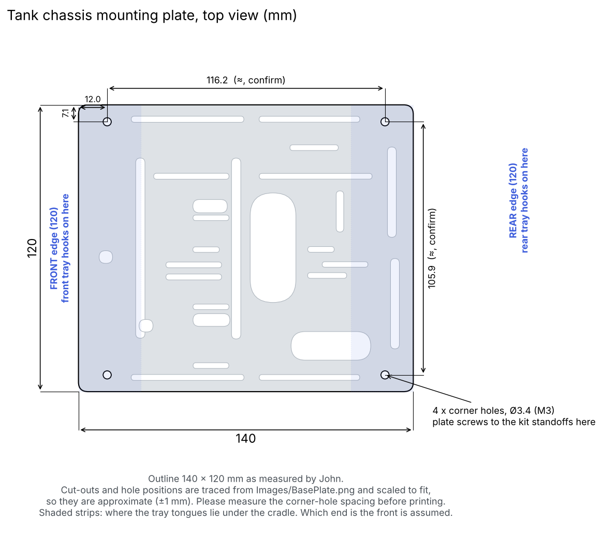
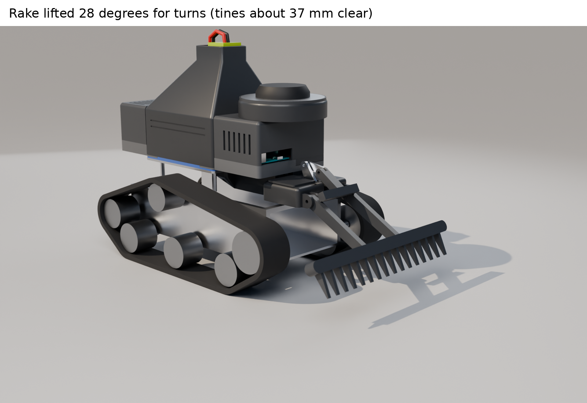
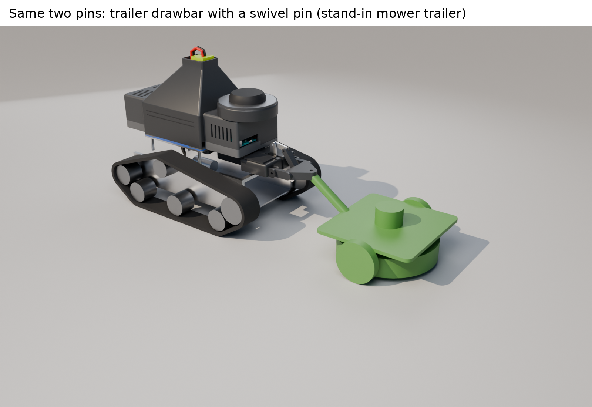
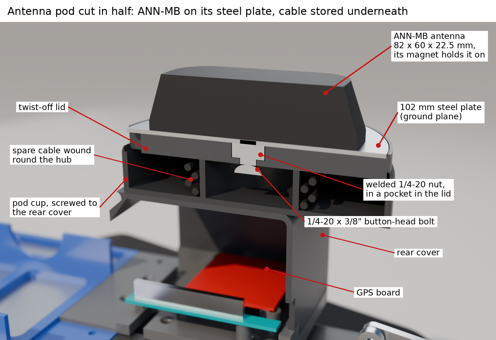
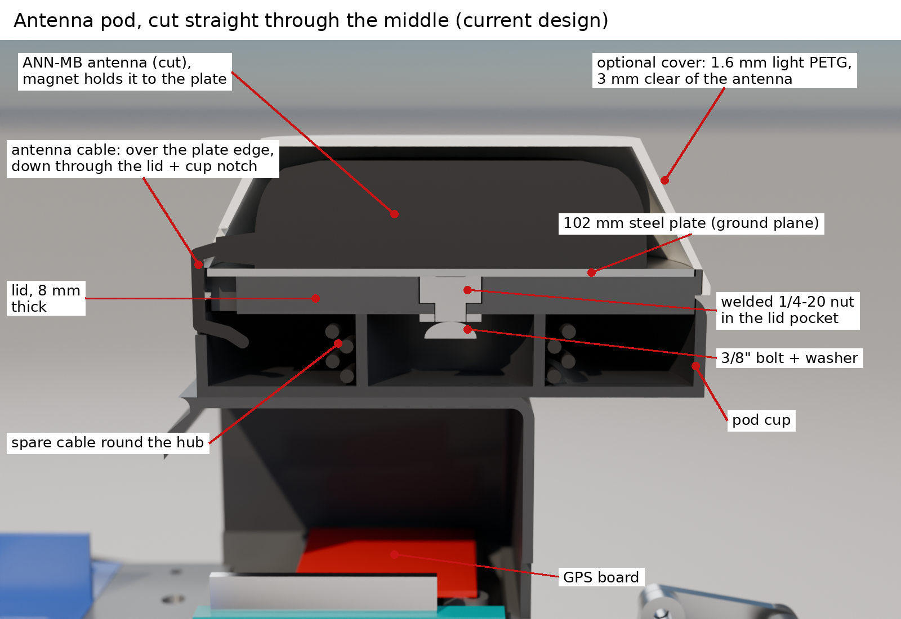
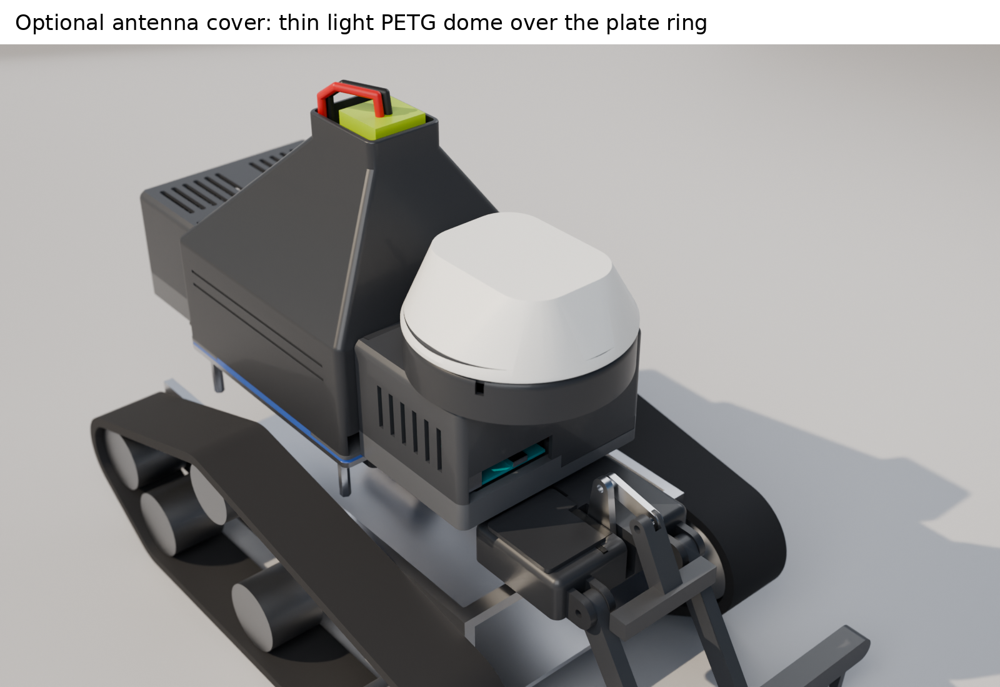

# Tank deck mount: Ryobi P108 battery + Power Wheel adapter + electronics, with casing

A printable mount and casing for the full-metal tank chassis (plate 152 x 135 mm):

- **Battery cradle** in the middle, on the plate. The Ryobi P108 4 Ah battery (136 x 75.6 mm, 720 g) stands in it along the 152 mm side, with the Power Wheel adapter (84 x 75 mm base, 90 mm tall) on top: 150 mm together. No boards are above the battery.
- **Front tray** overhanging the front 135 mm edge by 62 mm, carrying both IBT-2 drivers, heatsinks up.
- **Rear tray** overhanging the rear 135 mm edge by 90 mm, carrying the UNO R4 WiFi (USB-C facing the rear) and the GPS board.
- **Casing**: a hood over the battery that shows only the top of the adapter, and a cover over each tray. No tools needed.

The trays are built to take knocks: a 5 mm floor, a 5 mm bumper wall across the outer end, 3 mm side walls, corner gussets, and a cross rib where the tray meets the plate. The cradle's bottom is flat everywhere, so it prints with no supports. Its two ends are 2 mm thick, with an open pocket on top. Each tray has a 2 mm tongue that lies in that pocket, flush with the cradle floor (a half-lap joint), and the kit's corner screws clamp tongue + cradle to the metal plate. So the trays sit 2 mm above the plate.

Source: `tank_deck_mount.scad` (OpenSCAD, fully parametric). STLs are in `stl/`, pictures in `images/`, the 2-D drawings come from `drawings/make_drawings.py`, and the realistic renders from `render/` (Blender Cycles).

## Renders

| | |
|---|---|
|  |  |
|  |  |



The chassis in the renders is traced from John's side and rear photos (2026-11-25): the plate sits toward the front, the lower chassis runs 100 mm past the plate's rear edge with its top 30 mm below the plate, the tracks end about 140 mm behind the plate, and the plate top is 130 mm above the ground (measured). The battery and boards are stand-ins. Only the printed parts are to scale from the CAD.

## Drawings




## Changing the battery (no tools)

The hood's end walls (1.2 mm) are what hold the battery's ends, so the full 152 mm plate goes to the battery. Once the hood is off, nothing stands beside the battery above the 22 mm cradle walls, so there's room for your fingers on both release latches.

1. Lift the hood straight up. It slides off over the adapter.
2. Lift the adapter straight up and set it beside the tank. Its leads stay connected (250 mm lead).
3. Lift the battery straight out. Finger scoops in the cradle walls give you a grip.

Reverse to refit. The hood's two lips drop into seats on the front and rear covers, which is what holds the covers down.

**Fit clearances:** 0.4 mm between the hood's end walls and the covers, 0.4 mm around each lip in its seat, 2.5 mm around the adapter's upright (16.5 mm in front of it), 0.8 mm at each end of the battery and about 20 mm at its sides. The hood sits on the cradle floor and the tray tongues.

## Rear hitch (trailers and the sand rake)


| | |
|---|---|
|  |  |

Source: `hitch.scad`. It works like a small tractor hitch, so any tool swaps by pulling 3 pins:

- **Two lower pins** (M4 x 30 with R-clips) at the back of the hitch head, 60 mm apart. A tool or a trailer drawbar hangs on them and can pivot up and down.
- **One lift point.** A DS3235 servo (35 kg·cm, metal gear) lies in the hitch head and swings a lift arm. A short link pins from the arm to the tool's mast.
- **Sand rake:** 230 mm wide, 4 mm tines 28 mm long. Its arms reach down so the tines just touch the ground at rest (`ground_z`, 130 mm below the plate top, measured by John). It runs from 8° deeper than that to 28° raised, where the tines are about 37 mm clear of the ground, for turns. The rake bar sits about 40 mm behind the end of the tracks. The servo sets the depth. At full drag (about 20 N, which is about all the tracks can pull) it needs about 2.1 N·m, under two thirds of the servo's 3.4 N·m, so feed the servo 6 to 7.4 V rather than 5 V.
- **Trailer:** the drawbar hangs on the same two pins and is held level by the link. A 6 mm vertical swivel pin at its back end takes the trailer's tongue eye. The mower trailer in the render is a stand-in.

**Fit to the real chassis:** the lower chassis runs on 100 mm past the plate's rear edge with its top 30 mm below the plate (John). Nothing on the hitch goes lower than 27 mm below the plate, so it rides 3 mm above that part. The lower pins sit 38 mm behind its end. The clamp under the plate stops short of the corner screws' nuts.

**Mounting to the metal:** a clamp sits under the plate's rear edge. 4x countersunk M3 x 16 go down through the rear tray's tongue, the cradle's end and the plate's two long rear slots into nuts in the clamp. They sit flush, so the battery stands on them. The rear tray floor is screwed down onto the hitch beam with 2x countersunk M3 x 12, so knocks on the rear tray also go into the plate.

**Servo cable:** it runs from the servo pocket in a channel along the top of the beam, which the rear tray floor closes. It then comes up through the rear tray's wire slot to the UNO (D3). No wire shows.

| STL | Qty | Notes |
|---|---|---|
| `hitch_hitch.stl` | 1 | Clamp, beam and head in one piece, printed upright (flat bottom). The clamp wings have 45° undersides. Use 6 walls and 40% infill |
| `hitch_lid.stl` | 1 | Servo pocket lid, 2x M3 |
| `hitch_lift_arm.stl` | 1 | Bolts to the servo's round metal horn |
| `hitch_link.stl` | 1 | Arm to tool mast, M4 pins |
| `hitch_rake_frame.stl`, `hitch_rake_bar.stl` | 1 each | Rake. The bar prints tines-up. Join them with 2x M3 |
| `hitch_drawbar.stl` | 1 | Trailer adapter |

**Check before printing the hitch:**
- The plate's rear slots are now measured (John, 2026-11-25): centre line 10 mm in from the rear edge, slots at 20 to 62 and 82 to 127 mm from the long edge. The 4 bolts sit at 26, 56, 86 and 108 mm. The clamp stays clear of the rear corner screws' nuts (13.5 mm in, 7.5 mm from each side). `images/15_measure_rear_slots.png` shows them. The slots are 4 mm wide, so M3 screws pass with room to spare.
- That nothing sits under the plate's rear 17 mm, above the lower chassis.
- The plate thickness is 3 mm (measured).

## GPS antenna pod


Source: `antenna_pod.scad`. A round pod sits on top of the rear cover, held by 3x M3 with nuts inside the cover:

- **Antenna:** a u-blox ANN-MB (82 x 60 x 22.5 mm, 5 m RG174 cable). Its magnetic base sticks to your 102 mm steel plate, so it needs no screws. Keep the plate: the antenna is a patch type, and u-blox specs it on a 150 mm metal ground plane. The plate is that ground plane, and it helps with gain and with rejecting signals bouncing up from below. A 1/4-20 x 3/8" button-head bolt comes up through the pod lid into the plate's welded nut, which drops into a pocket in the top of the lid so the plate sits flat. A 1 mm lip around the plate keeps it centred. Use a 3/8" bolt with one 1/4" flat washer under its head. Anything longer bottoms out on the plate before it tightens.

  


- **Cord storage:** under the lid is a cup with a 40 mm hub. Wind the spare antenna cable round the hub; 40 mm is gentle enough for RG174, and the cup holds the spare of the 5 m cable with room to spare. The cable drops through a 10 mm hole into the rear tray, right above the GPS board, so an SMA plug fits through.
- **Lid:** twists off with a 3-lug bayonet. Turn the plate so the antenna's cable end points at the notch in the lid's rim. The cable goes over the plate's edge, down through that notch and the matching notch in the cup's rim (there are three, one for each lock position), and under the lid into the cup.
- **Cover (optional):** `antenna_pod_radome.stl` is a thin dome that slides over the plate ring, with a notch for the cable. It clears the antenna by 3 mm all round. A 1.6 mm wall of plain PETG, PLA or ASA barely affects GPS signals (typically a few tenths of a dB). Print it in a plain colour, ideally white or light grey (which also keeps the antenna cooler in the sun). Don't use carbon-fibre or metal-filled filament, and don't paint it with metallic paint.

  
- **Clearances:** the pod starts 8 mm behind the hood's lip, so the hood still lifts straight off. It sits about 70 mm above the hitch, clear of the lift arm. The antenna's top is about 115 mm above the plate, below the adapter's top.

| STL | Notes |
|---|---|
| `antenna_pod_cup.stl` | Print floor down |
| `antenna_pod_lid.stl` | Print flat, lugs down |
| `antenna_pod_radome.stl` | Optional cover; print top down as loaded, no supports |

## Power: no DC-DC converter needed

- **IBT-2:** the BTS7960 motor supply runs up to about 27 V, and the Ryobi pack is 18 V nominal, about 20 V full. Feed the IBT-2's logic VCC from the UNO's 5 V, never from the battery.
- **UNO R4 WiFi:** VIN accepts 6 to 24 V, so it runs straight from the pack.
- **Motors:** rated 7 to 15 V (John). A full pack is about 20.5 V, so cap the PWM at 70% in the sketch (`analogWrite` 180 out of 255). That gives about 14 V on a full pack and about 12.5 V near empty. A buck converter isn't needed.

## Wire routing (only the adapter's leads show)

- **Adapter leads** come out of the top of the adapter. They loop over and drop down inside the hood's tower, in the 16.5 mm gap in front of the adapter, to the left of the rocker switch. A 36 x 44 mm finger opening runs straight in through the hood's front slope and the tower's front face to the switch. Keep the leads and fuse holder to one side of the switch so the rocker stays clear. Inside, they run forward over the adapter's base onto the front of the battery's top, over its left edge, and down the gap outside the left cradle wall (the 35 x 10 x 35 fuse holder hangs there). Then they run forward along the left lane to the IBT-2s. They never pass through or under the battery. Because the leads sit inside the tower opening, the hood still lifts straight off over them, and you don't unplug anything to change the battery. Leave about 150 mm of slack so the adapter can be set beside the tank.
- **Hidden side lanes:** two 13 mm channels run the length of the plate between the cradle walls and the hood's sides. Passages in both ends of the hood lead into the trays, and notches in each tray's rib let the wires pass under the boards.
- **Motor wires** come up from the chassis through the plate's edge slots, which are under the hood, and run forward along the lanes to the IBT-2 motor terminals (left motor to the left driver).
- **Signals** (UNO to both IBT-2s) and a thin 18 V feed to the UNO's VIN run along the right lane between the trays. The GPS wiring stays inside the rear cover.
- The USB-C port is reached through the window in the rear cover and is only used for programming.

## Rounded edges (5 mm)

All outside edges of the hood, the covers and the tray bumper corners have a 5 mm radius. Exceptions, where 5 mm doesn't fit:

| Where | Radius | Why |
|---|---|---|
| Hood tower top rim | 1.2 mm | The wall is only 2.4 mm thick |
| Hood lip tips | 2.5 mm | The lip tip is 3 mm thick |
| Hood bottom edge, cover bottom edges, tray wall tops | square | Mating faces, so the seams close flush |
| Cover ends against the hood | square | Mating face with the hood's end wall |
| Bottom edges on the print bed (trays, base, hood) | square | A radius on the bed edge would be an unsupported overhang |
| Cover top edges, last 1.5 mm | 45° chamfer blended into the 5 mm round | The covers print top down, so this keeps the bed edge printable. It looks the same as the full round |
| Inside corners of the shells | 2.6 mm | 5 mm outside minus the 2.4 mm wall |
| Base cradle | 5 mm on the outside corners only | It's hidden under the hood |

## How the casing stays on

- **Hood:** located by its tower around the adapter (2.5 mm clearance) and by its own weight. It just lifts off.
- **Covers:** each one has a tab with a small nub at the outer end that drops into a pocket in the tray's bumper. Tilt the cover in, tab first, then lower the plate end. A 1.6 mm skirt along each side of the cover drops into a step on top of the tray's side walls (flush outside), with two snap bumps per side, so the sides can't lift or slide ([picture](images/28_cover_side_lock.png)). The hood's lip then sits on top of the cover's plate end and stops it lifting. To remove a cover, take the hood off first.
- **Openings:** vent slots over both IBT-2 heatsinks and a grille in the front face. In the rear cover: a window for the UNO's USB-C and barrel jack, side vents next to the UNO, and a 10 mm hole under the antenna pod for the antenna cable. The hood has wire passages at both bottom ends into the trays

## Parts

| STL | Qty | Size (mm) | Print orientation |
|---|---|---|---|
| `deck_mount_base.stl` | 1 | 152 x 135 x 22 | Floor down, flat bottom, no supports |
| `deck_mount_front_tray.stl` | 1 | 92 x 135 x 16 | Floor down |
| `deck_mount_rear_tray.stl` | 1 | 120 x 135 x 16 | Floor down |
| `deck_mount_hood.stl` | 1 | 164 x 135 x 146 | Open side down. The shoulder slopes at 45° or steeper, and the lips have 45° undersides |
| `deck_mount_front_cover.stl` | 1 | 62 x 116 x 60 | Top down (the STL is already flipped) |
| `deck_mount_rear_cover.stl` | 1 | 90 x 116 x 60 | Top down (the STL is already flipped) |

None of them need supports, and all fit the A1's 256 mm bed. About 300 g of PETG at the settings below.

## Balance

The battery and adapter (about 1 kg) stay centred on the plate. The front tray carries about 130 g of drivers about 100 mm ahead of the plate centre, and the rear tray about 40 g about 110 mm behind it. The casing is close to symmetric. The centre of mass moves about 6 to 7 mm forward, and less once the motors and tracks are counted.

## Dimensions and where they came from

| Item | Value | Source |
|---|---|---|
| Chassis plate | 152 x 135 x 3 mm | Measured by John (2026-11-25) |
| Plate corner holes | 125 mm front to back x 120 mm side to side, centred (13.5 / 7.5 mm in from the edges) | Measured by John |
| P108 battery footprint | 136 x 75.6 mm, cell housing 53.1 tall. The pocket is 137.6 x 77.6 (1.6 mm play on the length, 2 mm on the width) | John, 2026-11-25 |
| Battery + adapter height | 150 mm | Measured by John |
| Power Wheel adapter | 84 x 75 mm base, 90 mm tall, 250 mm lead | Listing photo |
| Adapter tower | 30 x 30 mm, 90 mm above the battery, leads out the top, rocker switch on its front face about 40 mm below the top. The switch face is 80 mm behind the battery's flat front end, so the upright sits 27 mm behind the middle (battery flat end forward, curved end back) (casing opening 49 x 39, with a 16.5 mm gap in front) | Measured by John; switch height from his photo |
| Fuse holder | 35 x 10 x 35 mm, on the red lead | Measured by John |
| IBT-2 | 50 x 50 board, 40 x 40 holes, about 43 tall | `Archive/MotorBox.f3d` |
| GPS | 43.2 board, 38.1 holes (SparkFun GPS-RTK2) | `Archive/GPSBox.f3d` |
| UNO R4 WiFi | Standard UNO pattern | Arduino datasheet |

### Check before printing

1. **Clearance past the 135 mm ends.** The trays sit 2 to 17 mm above the plate, the covers reach 69 mm, and they stick out 62 mm forward and 90 mm back. Check that the side frames, the front slope and the rear rake don't get in the way. `front_ovh`, `rear_ovh` and `tray_W` (116, inside the plate width) are adjustable.
2. **Which end is the front.** From John's photos, the rear is the end where the lower chassis runs on 100 mm past the plate; the hitch goes there. The IBT-2s go at the front. Swap the trays if not; the tongues are the same.
3. **Corner holes:** 125 x 120, measured. Print the base first and test-fit it on the plate.
4. **Battery length.** The hood's end walls take a battery up to 136.8 mm. The file refuses to render if `bat_L` doesn't fit.
5. **Switch height.** The switch faces the front (John). Its height (`sw_drop`, 40 mm below the top) is from a photo.

## Hardware

- 4x M3 corner screws through cradle + tongue into the chassis. The stack is 4 mm thick, so use the kit screws plus 4 mm.
- 16x M3 x 20 + nut for the boards: 8 for the IBT-2s, 4 for the UNO and 4 for the GPS. Each goes down through the board, the 11 mm printed standoff and the 5 mm tray floor, with the nut underneath (see `images/20_standoffs.png`).
- Cable ties through the slots near each plate edge to hold the wiring.

## Print settings (PETG, Bambu A1 or similar)

- 0.4 mm nozzle, 0.2 mm layers, 4 walls, 5 top and bottom layers, 25% gyroid infill.
- Nozzle 240 to 250 °C, bed 70 to 80 °C, textured PEI or glue stick.
- No supports. Each STL is already in its print orientation (see Parts). Every part fits a 256 mm bed. For a slick finish on the casing, print it in matte black PETG with 0.16 mm layers and use a textured PEI sheet for the covers (they print top down).

## Changing the design

Every dimension is a named variable at the top of `tank_deck_mount.scad`:

```
openscad -D 'part="front_tray"' -o stl/deck_mount_front_tray.stl tank_deck_mount.scad
```

`part` can be `assembly`, `base`, `front_tray`, `rear_tray`, `hood`, `front_cover` or `rear_cover`. In `antenna_pod.scad` it can be `pod_cup`, `pod_lid` or `pod_asm`. In `hitch.scad` it can be `hitch`, `lid`, `lift_arm`, `link`, `rake_frame`, `rake_bar`, `drawbar` or `hitch_asm`, plus `tool` and `rake_lift` for the pictures. The assembly also takes `hood_lift`, `cap_lift`, `bat_lift`, `explode` and `show_case` for the pictures.

Realistic renders: `render/parts.scad` exports the scene meshes, and `render/render.py` renders them with Blender's Python module (`pip install bpy`):

```
python render/render.py -- <mesh folder> out.png front34 64
```
