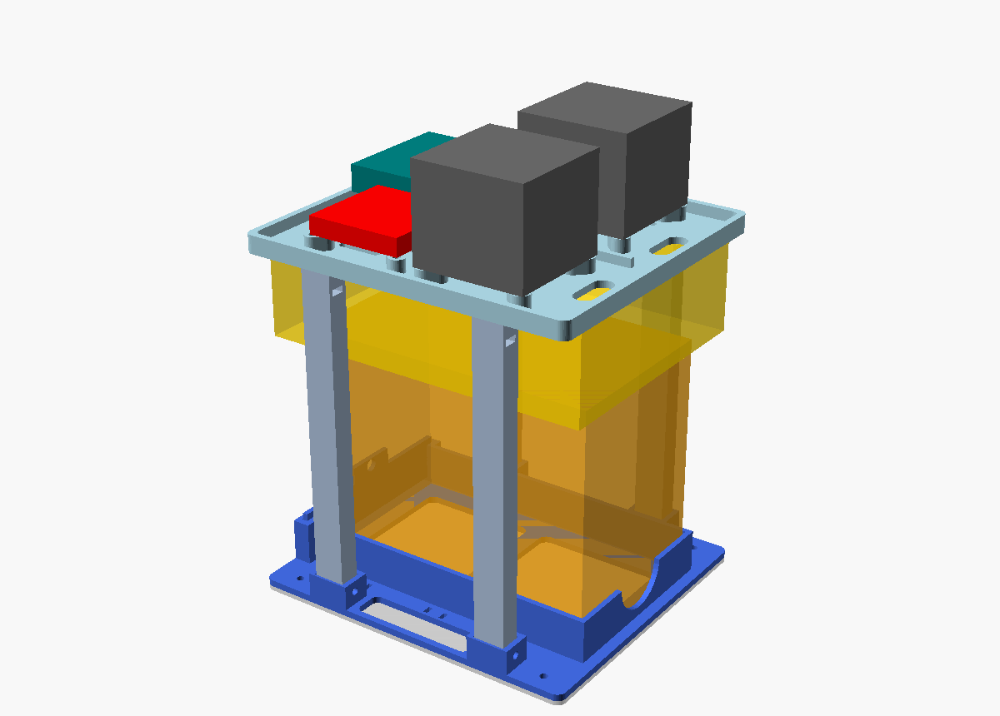
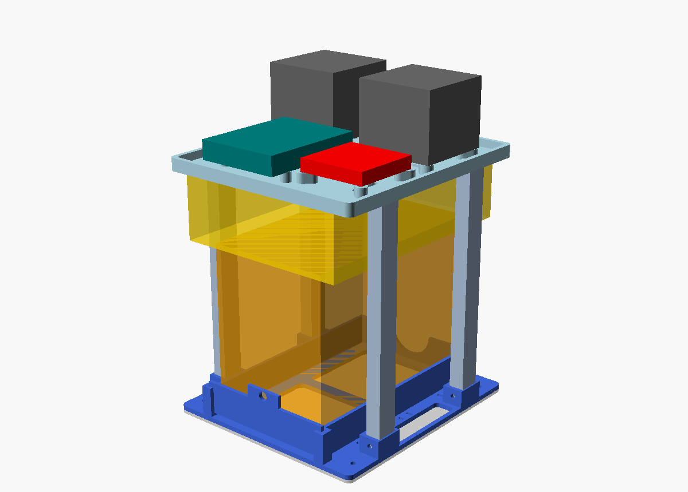

# Tank deck mount: Ryobi battery + electronics

A printable two-tier mount for the full-metal tank chassis. The Ryobi ONE+ battery stands rails-up in a cradle bolted to the chassis top plate. Its cap (the RyobiBatteryHolder) bolts to the underside of a deck on four posts, so the battery slides in and out of the cap the same way it does on a tool. The deck also carries the two IBT-2 drivers, the UNO R4 WiFi and the ZED-F9P GPS board.




Source: `tank_deck_mount.scad` (OpenSCAD, fully parametric). STLs are in `stl/`.

## Parts

| STL | Qty | Size (mm) | Notes |
|---|---|---|---|
| `deck_mount_base.stl` | 1 | 151.6 x 135.3 x 22 | Battery cradle. Bolts to the chassis plate through the 4 corner holes |
| `deck_mount_post_x4.stl` | 4 | 14 x 9.6 x 150.5 | Deck posts, along the two long edges. The STL is already lying on its side |
| `deck_mount_deck.stl` | 1 | 151.6 x 135.3 x 9 | Electronics deck |
| `deck_mount_gate.stl` | 1 | 89 x 28 x 2.4 | Optional rear gate. Only needed if the cap has no latch |

About 170 to 210 g of PETG in total at the settings below (267 g if printed solid).

## Where the dimensions came from

| Item | Value | Source |
|---|---|---|
| Chassis top plate | 151.6 x 135.3 mm | Measured from `Images/BasePlate.png` (a 300 dpi scan). The kit drawing in `Archive/TankSpecs.docx` gives 138 mm across |
| Plate corner holes | 4 holes, 125.8 x 119.4 mm apart, at (13.0, 7.9) from the corner | Same scan |
| Battery footprint | 80 x 135 mm | Battery block in `Archive/Battery+VR.f3d` |
| Battery + cap height | 150 mm, standing rails-up | Measured by John |
| Cap footprint | 110 x 148 mm | `Archive/RyobiBatteryHolder v7.f3d` |
| IBT-2 holes | 40 x 40 mm square, 50 x 50 mm board | Standoffs in `Archive/MotorBox.f3d` |
| GPS board holes | 38.1 x 38.1 mm square, 43.2 mm board (SparkFun GPS-RTK2) | Standoffs in `Archive/GPSBox.f3d` |
| UNO R4 WiFi holes | Standard UNO pattern, 68.6 x 53.3 mm board | Arduino datasheet |

### Please measure before printing

1. **Cap mounting holes.** The deck has four 20 mm long M3 slots, 90 mm apart across the tank, at 40 mm from each end. If your cap's holes don't land in them, send me the hole positions and I'll move the slots. The cap is 110 mm wide and the posts leave about 1.8 mm each side, so a wider cap needs thinner posts (`post_y`). The file refuses to render if they collide.
2. **Corner holes.** They come from a scan, so they could be off by up to about 0.5 mm. Print the base and test-fit it before printing the rest. The cradle is the part that has to match the chassis.
3. **Front of the tank.** The scan doesn't show which edge is the front. The layout assumes X = 0 (the edge with the battery stop wall and the IBT-2s) is the front. If the motor wires come up at the other end, the deck is fine either way round. Just turn it 180°.

The IBT-2 and GPS standoffs have radial slots, so a board whose hole spacing is off by up to about 2.5 mm from the value above will still fit.

## Layout choices

**Weight and centre of gravity.** The battery is the heaviest item by far (roughly 0.7 to 1 kg for a tall HP pack, against 1.2 kg for the chassis). It stands directly on the plate, centred across the tank and along the deck. That's as low as it can go upright. The electronics weigh about 250 g. They go on the deck because they are light, and because the GPS needs a clear view of the sky. The deck surface ends up about 154 mm above the chassis plate.

A rough estimate: chassis 1.2 kg with its centre of gravity about 50 mm off the ground, battery + cap 0.9 kg centred about 180 mm up, printed parts 0.25 kg at about 200 mm, and electronics 0.25 kg at about 285 mm. That puts the whole tank's centre of gravity about 130 mm above the ground. With the tracks about 195 mm apart centre to centre, it would tip sideways at about 36°. The kit is rated to climb 30°, so there is some margin, but avoid steep side slopes. These figures are estimates, not measurements. A quick tilt test on a board will give the real number. The only way to get much lower would be to lay the battery on its side, but at 150 mm it is wider than the 135 mm plate.

**Battery swap (no tools).** The cap is bolted under the deck with its rails running front to back and its open end facing the rear. The battery stands in the cradle (front stop wall, 22 mm side walls, open rear end). To take it out for charging, press the battery's latch and slide it straight out of the back, exactly as you'd pull it off a tool. To put it back, slide it in from the rear until it clicks. The deck and cap stay put. The posts sit along the side edges, so nothing blocks the rear. If your cap has no latch, drop the optional gate into its slots behind the battery.

**Wire runs.**
- Motor leads come up through the two front slots, right in front of the IBT-2 output terminals.
- Battery power runs up the back or side of the stack to the drivers and the buck converter(s), through the slots between the drivers and the UNO.
- PWM leads to the UNO (D5/D6/D9/D10) are short because the UNO sits right behind the drivers.
- GPS TX/RX (pins 0/1) and 3.3 V go through the slot beside the GPS board. They stay away from the motor wiring.
- The side channels of the base (beside the battery) have cable-tie slots. That's a good place for the buck converter(s) and the main fuse. The deck has more cable-tie slots at its rear.
- The UNO's USB-C and barrel jack face the rear edge, so you can plug in for programming without taking anything apart.

**IBT-2 cooling.** The XR25-370 motors draw 1.5 A rated and under 5.5 A at stall (kit datasheet). The BTS7960 chips are rated 43 A, so they will barely get warm. Even so, the drivers stand on 6 mm standoffs over open air slots, with their heatsinks up in free air at the front. Nothing encloses them.

**GPS antenna.** The ZED-F9P works best with its antenna as high as possible over a ground plane (for example a 100 mm steel disc for the ANN-MB magnetic antenna) and away from the motor wiring. The rear right of the deck is the furthest point from the drivers. If you want, I can add a small antenna mast or ground-plate mount to the deck.

## Hardware

- 4x M3 screws to the chassis, through the 4 corner holes in the cradle floor. Use the original kit screws plus 3 mm of length, since the floor is 3 mm.
- 4x M3 x 20 + nylock nut as cross pins through the cups and posts. They go in along the length of the tank.
- 4x M3 x 12 + nut to fix the cap under the deck (through the cap slots).
- 4x M3 x 12 + M3 nut, deck to posts. The nut drops into the slot near the top of each post.
- 8x M3 x 12 + nut for the IBT-2s, 4x for the UNO and 4x for the GPS board.

## Print settings (PETG, Bambu A1 or similar)

- 0.4 mm nozzle, 0.2 mm layers, 4 walls, 5 top and bottom layers, 25% gyroid infill.
- Nozzle 240 to 250 °C, bed 70 to 80 °C. Use a textured PEI plate or glue stick. On smooth PEI, PETG can stick too well.
- No supports needed:
  - Base: floor down.
  - Deck: flat side down, standoffs up.
  - Posts: lying on their side, as the STL is oriented. This puts the layers along the post's length, which is much stronger in bending.
  - Gate: flat.
- All parts fit a 256 mm bed. Base and deck are 152 x 135 mm, and the posts are 150 mm long lying down.

## Changing the design

Every dimension is a named variable at the top of `tank_deck_mount.scad`. Export one part:

```
openscad -D 'part="base"' -o stl/deck_mount_base.stl tank_deck_mount.scad
```

`part` can be `assembly`, `base`, `deck`, `post` or `gate`. The assembly view shows the battery and boards as stand-in blocks.
